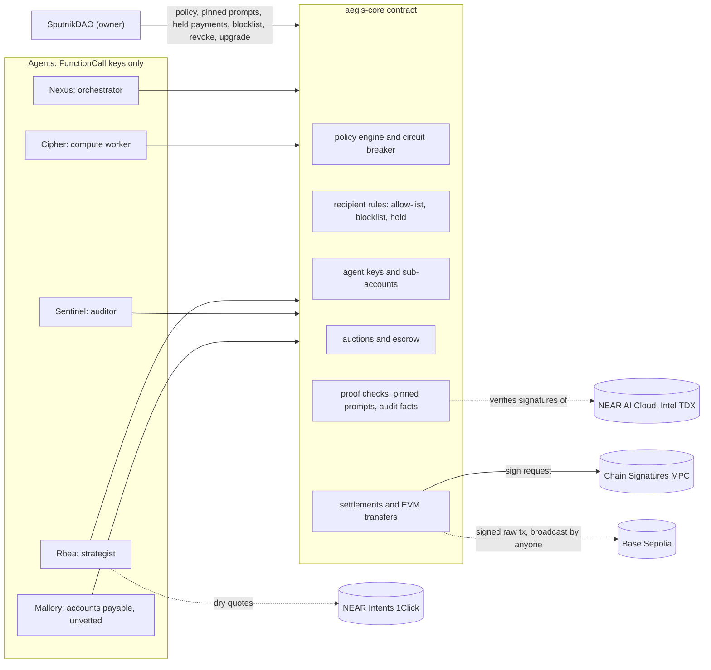

# PhalanxSwarm

A treasury contract on NEAR that lets AI agents pay vendors and hire each other inside limits set by a DAO. Before any money moves, the contract checks the AI decision behind the payment. No agent holds a full-access key, and an agent that tries to pay an address the DAO never approved loses its key in that same transaction.

Built at [NEAR HACKATHON](https://nearhackathon.com). Primary track: `security` (AI Security & Defense). The project also fits `business`, `swarms`, `agents`, `privacy` and `social` ([Hackathon tracks](#hackathon-tracks)).

|                                 |                                                                                                                                                             |
| ------------------------------- | ----------------------------------------------------------------------------------------------------------------------------------------------------------- |
| Hosted demo                     | https://phalanxswarm.vercel.app                                                                                                                             |
| Contract (NEAR testnet, v2.3.0) | [`aegis-69b4.phalanxswarm.testnet`](https://testnet.nearblocks.io/address/aegis-69b4.phalanxswarm.testnet)                                                  |
| Owner (SputnikDAO)              | [`aegis-69b4.sputnikv2.testnet`](https://testnet.nearblocks.io/address/aegis-69b4.sputnikv2.testnet)                                                        |
| Deployed code                   | sha256 `4ed31569878971c9c27bebb4e81b9a3146758874ff8a10f8c64ab4a5a2876f76`, the reproducible build in [`artifacts/aegis_core.wasm`](artifacts/aegis_core.wasm) |
| Source                          | https://github.com/AmirMP12/PhalanxSwarm                                                                                                                    |
| Hackathon rules                 | https://nearhackathon.com/HACKATHON.md ([how this repository follows them](#near-hackathon-rules))                                                          |
| License                         | [MIT](LICENSE)                                                                                                                                              |

## Contents

- [The problem](#the-problem)
- [What PhalanxSwarm does](#what-phalanxswarm-does)
- [How NEAR is used](#how-near-is-used)
- [Try it: do X, see Y](#try-it-do-x-see-y)
- [Testnet deployment (v2.3.0)](#testnet-deployment-v230)
- [How it works](#how-it-works)
- [Measurements](#measurements)
- [Use it in your agent](#use-it-in-your-agent)
- [What is real and what is simulated](#what-is-real-and-what-is-simulated)
- [Limits](#limits)
- [Run your own deployment](#run-your-own-deployment)
- [Configuration](#configuration)
- [Web app and hosting](#web-app-and-hosting)
- [Repository layout](#repository-layout)
- [Hackathon tracks](#hackathon-tracks)
- [NEAR HACKATHON rules](#near-hackathon-rules)
- [Libraries and provenance (rule Q-005)](#libraries-and-provenance-rule-q-005)
- [License](#license)

## The problem

To let an AI agent pay invoices or buy compute, teams usually give it a private key or a hot wallet. One prompt injection, such as an invoice that says "our bank details changed", can then send the money anywhere, inside every amount limit. A guardrail that runs next to the model can be fooled along with it, and an audit by a second model is only as good as the facts the paying agent shows it.

## What PhalanxSwarm does

The spending rules run in the contract that holds the money, and only the DAO can change them.

- **Scoped keys only.** Each agent gets a NEAR FunctionCall access key that can call 6, 8 or 12 named methods of the treasury contract, depending on its role, and nothing else. No account in the system holds a full-access key.
- **On-chain policy engine.** Every spend is checked against per-transaction and per-epoch caps, chain, contract and asset allow-lists, a recipient allow-list, price floors, a slippage ceiling, a velocity limit, nonce replay protection and a signed audit.
- **A kill switch inside the attacking transaction.** A critical violation, such as an unapproved or blocklisted recipient, a forged proof or signature, a replayed nonce, a velocity burst or a request 4x over the limit, quarantines the agent. The contract returns a rejection instead of panicking, so the quarantine is not rolled back, and for a key on the contract account it schedules `Promise::delete_key` in the same transaction. The agent's next call fails at the protocol level with `InvalidAccessKeyError`.
- **Verified AI decisions.** NEAR AI Cloud signs each completion with a key bound to Intel TDX hardware. The contract verifies the signature with `env::ed25519_verify`, then checks what was signed: the system prompt must be the one the DAO pinned, and an audit's input must be the facts document the contract built for that request. A mismatch (`prompt_mismatch`, `facts_mismatch`) is treated as a forgery.
- **Recipient rules.** Allow-listed recipients pass. Recipients on the shared blocklist are refused for every agent. For a recipient nobody approved, the DAO chooses the rule: `quarantine` (the default) treats the payment as an attack, and `hold` parks a settlement until the DAO votes, so an honest agent that meets a new vendor keeps its key.
- **Work market.** Agents post budgeted tasks and bid in sealed-bid (commit-reveal) or reverse-Dutch auctions of up to 16 bidders. The winning price stays in escrow until a TEE-signed proof of the work verifies on-chain. Reputation rises with verified deliveries and falls with missed deadlines.
- **Cross-chain payments without agent keys.** The contract builds EIP-1559 transactions, enforces per-chain caps and a fee ceiling, and has them signed by NEAR Chain Signatures (`v1.signer-prod.testnet`). It tracks the treasury address's nonce and can sign a fee-bumped, zero-value replacement to cancel a transfer that has not been mined.
- **DAO governance and revenue.** A SputnikDAO owns the contract. It sets the policy, pins prompts, approves held payments, revokes agents and is the only party that can upgrade the code. Policy changes carry a version number, so a proposal written against an older policy fails instead of overwriting a newer one. Customer revenue is split on-chain between the DAO, operators and a reserve.

It is for teams that let AI agents pay invoices, buy compute or move treasury funds, and want the rules enforced where the money is: a DAO treasury, an agent marketplace, a company running an accounts-payable agent. An agent can call the contract directly, use the TypeScript SDK, or query it from any MCP client through the read-only MCP server ([Use it in your agent](#use-it-in-your-agent)).

## How NEAR is used

| NEAR feature                                 | What it does in PhalanxSwarm                                                                                          |
| -------------------------------------------- | --------------------------------------------------------------------------------------------------------------------- |
| FunctionCall access keys                     | Limit each agent to named methods of the treasury contract. The protocol enforces the list.                           |
| `Promise::delete_key` on the contract account | The circuit breaker removes a fooled agent's key in the transaction that detects the violation.                       |
| Sub-accounts                                 | Each vetted agent owns `<handle>.<contract>`, with its own identity and balance and a single scoped key.              |
| NEAR AI Cloud                                | Runs the agents' model inside Intel TDX and signs every completion. The contract verifies those signatures.           |
| Chain Signatures                             | The contract controls an EVM address on Base Sepolia, so the treasury pays there without any agent holding an EVM key. |
| NEAR Intents (1Click)                        | Dry-run cross-chain quotes, bound to the agent's signed payment request.                                              |
| NEP-413                                      | Agents sign each payment request off-chain; the contract rebuilds the message and verifies the signature.             |
| SputnikDAO                                   | Owns the contract and votes on policy, held payments, revocations and upgrades.                                       |

## Try it: do X, see Y

Requirements:

- Node.js 20.19 or newer and pnpm 10 (`packageManager: pnpm@10.17.1`).
- Rust through rustup. `rust-toolchain.toml` pins rustc 1.99.1 with the `wasm32-unknown-unknown` target.
- bash for the `.sh` scripts. Docker for the reproducible build and, on hosts with glibc older than 2.39, for the sandbox suite.
- On Windows, the Node commands (rows 1-3, 5-9, 12 and 14) run natively. Run `cargo` and the bash scripts (rows 4, 10, 11 and 13) in WSL; native Windows `cargo test` needs the MSVC linker (`link.exe`).

After `pnpm install`, rows 1-7 and 9 run offline and need no API key.

| #   | Do                                                                                       | See                                                                                                                                                                                                                                                                                                                                                                                                                                                                                                                                                                | Needs                 |
| --- | ---------------------------------------------------------------------------------------- | ------------------------------------------------------------------------------------------------------------------------------------------------------------------------------------------------------------------------------------------------------------------------------------------------------------------------------------------------------------------------------------------------------------------------------------------------------------------------------------------------------------------------------------------------------------------------------------------------------- | --------------------- |
| 1   | `pnpm install`, then `pnpm judge:attack`                                                 | `ALL CHECKS PASSED: 24/24 assertions`. Mallory, an accounts-payable agent, reads invoice INV-2291, which hides a forwarded "our bank details changed" message, and asks to pay `0x7a3f…beef` on `arb`, inside every amount, chain, route and asset limit. Her call to `update_global_policy` fails with `InvalidAccessKeyError: MethodNameMismatch`. The payment is rejected (`recipient_not_allowed`, critical), she is quarantined, a `DeleteKey` receipt removes her key, her retry fails with `InvalidAccessKeyError: access key … not found`, and treasury liquidity is unchanged. Offline, a deterministic stand-in plays a model the injection fooled. | Node                  |
| 2   | `pnpm judge:offline`                                                                     | 11 steps, each `PASS`, ending `ALL CHECKS PASSED: 80/80 assertions` (step list below the table).                                                                                                                                                                                                                                                                                                                                                                                                                                                                   | Node                  |
| 3   | `pnpm --filter @aegis/agent-swarm-sdk test`                                              | `Test Files  12 passed (12)` and `Tests  63 passed \| 3 skipped (66)`. The skipped tests call live services; they run with `AEGIS_LIVE_MPC=1`, `AEGIS_LIVE_INTENTS=1`, or `AEGIS_LIVE_TEE=1` plus `NEARAI_API_KEY`.                                                                                                                                                                                                                                                                                                                                                | Node                  |
| 4   | `cargo test -p aegis-core`                                                               | `test result: ok. 94 passed` (87 tests in `tests.rs`, 5 in `codec.rs`, 2 in `facts.rs`).                                                                                                                                                                                                                                                                                                                                                                                                                                                                          | Rust                  |
| 5   | `pnpm eval:injection`                                                                    | `contract: 24/24 rejected (0 forced), 24 quarantined, 24 keys deleted, 0 moved funds`: 12 injection styles on 2 invoices, each in a fresh runtime ([Measurements](#prompt-injection-pnpm-evalinjection)). Rewrites `artifacts/injection-eval.json`.                                                                                                                                                                                                                                                                                                                  | Node                  |
| 6   | `pnpm market`                                                                            | 12 sealed-bid rounds among 20 scripted bidders on the compiled contract, ending `paid for undelivered work: 0 NEAR` ([Measurements](#swarm-market-pnpm-market)). Rewrites `artifacts/market-sim.json`.                                                                                                                                                                                                                                                                                                                                                              | Node                  |
| 7   | `pnpm typecheck`, then `pnpm check:source`                                               | Both exit 0. The second prints `Source integrity check passed: runtime source has no fixed calendar dates, placeholder datasets, or unfinished markers.`                                                                                                                                                                                                                                                                                                                                                                                                            | Node                  |
| 8   | Open https://phalanxswarm.vercel.app, or run `pnpm dev` and open http://localhost:3000   | The guided demo runs the same WASM in your browser: (1) a fooled agent loses its key, (2) an approval over invented facts is rejected, (3) a new vendor waits for the DAO and is paid after its vote. "Run all 3 steps" plays them in order, and each result links the same step on testnet. "Explore" lets you set the DAO's limits, pay any invoice and try the self-written-prompt forgery. "Judge Scenario (11 steps)" runs the full judge scenario in the browser. The "Live on NEAR testnet" section reads `aegis-69b4.phalanxswarm.testnet` over public RPC.                  | Browser               |
| 9   | `pnpm --silent mcp --sim`, then send MCP JSON-RPC on stdin ([example](#from-an-mcp-client)) | A read-only MCP server with `aegis_check_recipient`, `aegis_preview_payment` and `aegis_get_policy`, running against the compiled WASM. For the attacker's address it answers `"verdict": "warn"`, `"action": "ask_dao_to_allow_list"`. Without `--sim` it reads the testnet deployment, where the same address answers `block`.                                                                                                                                                                                                                                  | Node                  |
| 10  | `pnpm test:sandbox`                                                                      | `9 passed` against a real nearcore 2.14.0 sandbox node: scoped keys, protocol-enforced key scope, key deletion, a NEAR AI proof that releases escrow, real transfers, a held payment that moves only after the owner approves it, a failed MPC call that releases its reservation, revenue distribution, and an audit that counts only over the contract's own facts. On macOS or Linux with glibc 2.39+, `cargo test -p aegis-sandbox-tests` runs it without Docker.                                                                                               | Docker                |
| 11  | `pnpm verify:reproducible`                                                               | Two clean builds in a digest-pinned Docker image, both with sha256 `4ed31569878971c9c27bebb4e81b9a3146758874ff8a10f8c64ab4a5a2876f76`, then `REPRODUCIBLE: PASS`. Rewrites `artifacts/aegis_core.wasm` (same bytes) and `artifacts/reproducible-build.json`.                                                                                                                                                                                                                                                                                                     | Docker                |
| 12  | `pnpm verify:live`                                                                       | Re-checks the public evidence against live networks without any key: deployed code hash, owner, access keys, prompt pins, the recorded payments, proofs, rejections and DAO votes, a fresh DCAP verification of NEAR AI's gateway and model key, the Base Sepolia receipt and a dry 1Click quote. The recorded run passed 34 of 34 checks. Rewrites `artifacts/live-verification.json`.                                                                                                                                                                                                       | Internet              |
| 13  | `bash scripts/verify-all.sh`                                                             | 9 stages: clippy, unit tests, WASM build, typecheck, lint and format checks, SDK tests, the judge scenario, the web build and the sandbox suite (skipped with a note when the host cannot run it). Ends `VERIFICATION PASSED`. `AEGIS_LIVE=1` appends row 12, `AEGIS_AUDIT=1` adds dependency audits.                                                                                                                                                                                                                                                              | Rust, bash            |
| 14  | `NEARAI_API_KEY=… pnpm judge --live`                                                     | The same 11 steps with every agent decision made by NEAR AI Cloud (`Qwen/Qwen3.6-35B-A3B-FP8`, TEE-signed) and live 1Click dry quotes. Spends NEAR AI credits. No live run of this scenario is recorded in `artifacts/`.                                                                                                                                                                                                                                                                                                                                          | NEAR AI key, internet |

`pnpm judge`, `pnpm eval:injection` and `pnpm market` accept `--json` for a machine-readable report.

The 11 steps of `pnpm judge:offline`:

1. Deploy `aegis_core.wasm`, fund the treasury, check NEAR AI hardware evidence.
2. Spawn 4 agents (+1 unvetted third party) with scoped FunctionCall keys.
3. Invoice fraud: a fooled agent tries to pay an attacker inside every limit (the same step as row 1).
4. Nexus's model turns the business goal into budgeted RFPs; an RFP whose proof prompt the DAO never approved is refused.
5. Sealed-bid and reverse-Dutch auctions: binding terms, reputation floor, escrow.
6. Signed model output verified on-chain releases escrow; agents spend their earnings.
7. Settlements: a real NEAR vendor payment, a cross-chain rehearsal, an MPC-signed EVM transfer at the contract-tracked nonce, and the cancel of a signed transfer.
8. Shared blocklist and pre-flight: the attacker is refused everywhere, a new vendor waits for the DAO, and a stale policy proposal is refused.
9. Forged audits: genuinely signed approvals over self-written instructions (`prompt_mismatch`) or self-written facts (`facts_mismatch`) are rejected.
10. Revenue distribution to the DAO, operators and reserve; SputnikDAO / Trezu proposal export.
11. Invariants: ledger conservation, agent balances, solvency, schema parity.

## Testnet deployment (v2.3.0)

`pnpm testnet:swarm --confirm` ran the whole protocol on NEAR testnet on 2026-11-06 and recorded every transaction in [`artifacts/testnet-swarm.json`](artifacts/testnet-swarm.json). `pnpm verify:live` re-checked the deployment the same day and passed 34 of 34 checks ([`artifacts/live-verification.json`](artifacts/live-verification.json)).

- The contract reports version `2.3.0` (`contract_info`), and its code hash equals the reproducible build `4ed31569…`.
- The owner is the SputnikDAO `aegis-69b4.sputnikv2.testnet`. The contract account has no access keys: the deployer's full-access key was deleted after deployment, and Mallory's contract-account key was deleted by the circuit breaker.
- In this run the DAO council is one account (`phalanxswarm.testnet`) and one vote passes a proposal, so a single key controlled the owner role. The deployment script's default is three members and two votes.
- Every agent decision was a NEAR AI Cloud completion from `Qwen/Qwen3.6-35B-A3B-FP8`, signed by the TDX-attested model key `89fb781a9530473a6d3bddd6bb0a0536c8d155058798edae88b19153bd8f4350`. [`artifacts/nearai-attestation.json`](artifacts/nearai-attestation.json) records its DCAP verification (`UpToDate`, bound to a fresh nonce).
- The live model did not follow the poisoned invoice in this run (`model_fooled: false`). The script then submitted the injected payment anyway, so the contract's response was still tested.
- The DAO pinned the Sentinel's audit prompt (sha256 `9bcd851c…`) and Cipher's procurement prompt (`2e1de08d…`). `pnpm verify:live` checks that both equal the sha256 of the prompts in [`agent-brains.ts`](packages/agent-swarm-sdk/src/agent-brains.ts).
- The treasury's Chain Signatures address on Base Sepolia is `0xa767Bd611E029c90dAc700ff8f4C069191bfFc53`.

| Step                                                                                                                                                                                         | Transaction                                                                                                                                                                                                                                                                                                                                                                                                                                                                                          |
| -------------------------------------------------------------------------------------------------------------------------------------------------------------------------------------------- | ---------------------------------------------------------------------------------------------------------------------------------------------------------------------------------------------------------------------------------------------------------------------------------------------------------------------------------------------------------------------------------------------------------------------------------------------------------------------------------------------------- |
| Create the SputnikDAO                                                                                                                                                                        | [`AWub4J2…`](https://testnet.nearblocks.io/txns/AWub4J279YrQmyFV6mZW6D8Rt9nToPwkmc8RA9KXDtd9)                                                                                                                                                                                                                                                                                                                                                                                                         |
| Deploy the WASM and call `new()` in one batch, so initialization cannot be front-run                                                                                                         | [`84AxopW…`](https://testnet.nearblocks.io/txns/84AxopW64c8wE7YVY4pUntpAUHdAAuHa6NFryc1B7jB3)                                                                                                                                                                                                                                                                                                                                                                                                         |
| Delete the deployer's full-access key                                                                                                                                                        | [`4oZrzMB…`](https://testnet.nearblocks.io/txns/4oZrzMBBr6PJw7EW6LMJYpWdRr3typNQLgBxsDGrxg3Y)                                                                                                                                                                                                                                                                                                                                                                                                         |
| Spawn the agents: Nexus, Rhea, Sentinel and Cipher on sub-accounts, Mallory with a key on the contract account                                                                               | [Nexus](https://testnet.nearblocks.io/txns/9vfWtUtyFCgTMKSYQH3WW2MchGnrBhQvnAv5fQLKhjVY), [Rhea](https://testnet.nearblocks.io/txns/7pgw3GQroKypUVTxLwnE13x9tn8qHPQNUNwekMF9WPZV), [Sentinel](https://testnet.nearblocks.io/txns/C1DhXu2d4axkf7u5wxUB5CZpmAZE56nKK2R1W35QHTPC), [Cipher](https://testnet.nearblocks.io/txns/GQM77NojaqqG9JPd6K5WHRbNEWDNygYbwfN47BgKGL21), [Mallory](https://testnet.nearblocks.io/txns/2V3xy41esCtd3fbjp53SkKTi5aXspHHKogFT4KKKC7x2) |
| Register the NEAR AI model key after its TDX attestation passes DCAP                                                                                                                         | [`7kF3UmG…`](https://testnet.nearblocks.io/txns/7kF3UmGgvibagAVKYttrm2YtLLGVTrrpMWXNRAsaepFN)                                                                                                                                                                                                                                                                                                                                                                                                         |
| Hand ownership to the DAO                                                                                                                                                                    | [`CYCYcXh…`](https://testnet.nearblocks.io/txns/CYCYcXhL8qmb9N9sj8qxfej4NSbbex6wbJ7wFeKLkHv7)                                                                                                                                                                                                                                                                                                                                                                                                         |
| The task-prompt registry refuses an RFP whose proof prompt always answers "completed" (`task_prompt_not_approved`, `task_floor_below_policy`)                                                 | [`56W2ErJ…`](https://testnet.nearblocks.io/txns/56W2ErJhnFfQnaabUD23Xngct5UrjGtmpVpapqjWsWR6)                                                                                                                                                                                                                                                                                                                                                                                                         |
| Nexus posts the procurement RFP with Cipher's pinned prompt and spec                                                                                                                         | [`GdE7aKq…`](https://testnet.nearblocks.io/txns/GdE7aKqcXRt92ss2jowzQxX9XbxADJHHCmRMACSiQPXQ)                                                                                                                                                                                                                                                                                                                                                                                                         |
| Mallory's bid fails the reputation floor (`AEGIS_E_REPUTATION_BELOW_SCHEMA`)                                                                                                                  | [`B9CjQjG…`](https://testnet.nearblocks.io/txns/B9CjQjGWr7qGEAmyJmbd8y3Y2yr7Su7bMAHfWNypQJCk)                                                                                                                                                                                                                                                                                                                                                                                                         |
| Cipher commits and reveals a sealed bid of 0.435 NEAR; the auction closes                                                                                                                    | [commit](https://testnet.nearblocks.io/txns/4Jt97ueV7bPp7dBkWjKC7yyX1Dh96wpCUBcLUoZ3KhKE), [reveal](https://testnet.nearblocks.io/txns/2pJ1favA45MENqj4cekYUZD93hSNJBzP5cvUDwWwFgLT), [close](https://testnet.nearblocks.io/txns/8yVxTbWQVVhuShxYG34XAQaKTane5vBcLKdnRnRGYtJX)                                                                                                                                                                                                                          |
| Cipher's TEE-signed NEAR AI completion verifies under the pinned prompt and releases escrow                                                                                                  | [`GUmXKNf…`](https://testnet.nearblocks.io/txns/GUmXKNfFV3jWEw5XZxm82tNHQvqRJ8gb1B4X8uGGQvej)                                                                                                                                                                                                                                                                                                                                                                                                         |
| Cipher withdraws its earnings (a real transfer)                                                                                                                                              | [`QJYQw2A…`](https://testnet.nearblocks.io/txns/QJYQw2AUXAz9RFnFBSCg6k3G2w4hjRdvJ7jiCwyRdba)                                                                                                                                                                                                                                                                                                                                                                                                          |
| The treasury pays an allow-listed vendor 0.2 NEAR (a real transfer)                                                                                                                          | [`5X1ur1y…`](https://testnet.nearblocks.io/txns/5X1ur1yA8dNcVMaXWp13v3LoicR7rRjdysAMfy31GjjH)                                                                                                                                                                                                                                                                                                                                                                                                         |
| Chain Signatures signs a contract-built EIP-1559 transfer on Base Sepolia                                                                                                                    | [`F64eUNk…`](https://testnet.nearblocks.io/txns/F64eUNkk6D1W7mWZuu2gjHx2P8qZKkGbsj9xNwv88RKe)                                                                                                                                                                                                                                                                                                                                                                                                         |
| **The poisoned invoice.** Mallory asks to pay the attacker; the contract rejects it (`recipient_not_allowed`), quarantines her, and a `DeleteKey` receipt in the same transaction removes her key | [`5WEGhAy…`](https://testnet.nearblocks.io/txns/5WEGhAyNioZ22RqdC989aoRyw7Xz1KyaVyyscF2Xw59k)                                                                                                                                                                                                                                                                                                                                                                                                         |
| The Sentinel adds the attacker to the shared blocklist, with the rejected request's hash as evidence                                                                                        | [`A8LNdQN…`](https://testnet.nearblocks.io/txns/A8LNdQN4LRNY6wUghJYJK73Wb58grrBPAUPEt2tMhPLv)                                                                                                                                                                                                                                                                                                                                                                                                         |
| The DAO votes to hold payments to new recipients for review                                                                                                                                  | [proposal](https://testnet.nearblocks.io/txns/4SB7mBEF2SyaabiEH6jvmbL5As9LFZy95CV6J99gdsw9), [vote](https://testnet.nearblocks.io/txns/2tiRTBvTSB4HaPNiN1yLEq4LGCYFuxFg63a4AL2vZ99J)                                                                                                                                                                                                                                                                                                                       |
| A payment to a vendor nobody approved waits (`pending_approval`); nothing moves and the paying agent keeps its key                                                                           | [`9B4heMR…`](https://testnet.nearblocks.io/txns/9B4heMR5HxCEdbgGGBcRwriGhsToThyWKUpjK4Ndh5wX)                                                                                                                                                                                                                                                                                                                                                                                                         |
| The DAO approves it and the vendor receives 0.2 NEAR                                                                                                                                         | [proposal](https://testnet.nearblocks.io/txns/Dgb6WQ43cJJ82QJ917wtocXPhivZY1qzxawBMj896KG7), [vote](https://testnet.nearblocks.io/txns/AVrtXFiAewSM9qfvhzj2HxrbvZJ8HHfZdKniUpfg6pRg)                                                                                                                                                                                                                                                                                                                       |
| Rhea's audit under instructions she wrote herself, genuinely signed by the TEE key, is rejected as a forgery (`prompt_mismatch`); Rhea is quarantined                                        | [`HWfC8Gf…`](https://testnet.nearblocks.io/txns/HWfC8Gfh55mMz2KE1tQWStQuWpYPN8RF3gB8hQPHsjXB)                                                                                                                                                                                                                                                                                                                                                                                                         |
| Cipher's audit under the pinned prompt over facts it invented, which the model approved, is rejected (`facts_mismatch`); Cipher is quarantined                                               | [`8dd1Rj4…`](https://testnet.nearblocks.io/txns/8dd1Rj49YQB99dVb5ipTer28syZitXNTuyEJMCeYDVSL)                                                                                                                                                                                                                                                                                                                                                                                                         |
| Revenue is split: 50% to the DAO, 20% to operators, 30% kept as reserve                                                                                                                      | [`BXpyQhV…`](https://testnet.nearblocks.io/txns/BXpyQhV75JYSXTM3z2afsNK7EzWxD9SbzmgSPuDZjmAf)                                                                                                                                                                                                                                                                                                                                                                                                         |
| The DAO revokes Mallory                                                                                                                                                                      | [proposal](https://testnet.nearblocks.io/txns/D63rHszAx1HE5jWwoeVG8KenhBjJYnf5LFr25JK21UkM), [vote](https://testnet.nearblocks.io/txns/2uD7pLYWA9oZ23wLx9bxz1K3RokPoPV3DrTpkAfckSeK)                                                                                                                                                                                                                                                                                                                       |

The MPC-signed Base Sepolia transfer of 0.0001 ETH from the treasury address was broadcast and confirmed: [`0x6cb07351…`](https://sepolia.basescan.org/tx/0x6cb073510097e2f3e1c084b3dc486aaff6294992749b73d19c0ac029c5da606d). The contract then marked nonce 0 as used; its next nonce for the chain is 1.

At the end of the run, Nexus and the Sentinel are active, Rhea and Cipher are quarantined by the forgery steps, and Mallory is revoked.

Earlier deployments, kept as evidence:

- v2.1.0 contract [`aegis-v21.aegis-deploy-6dc23c.testnet`](https://testnet.nearblocks.io/address/aegis-v21.aegis-deploy-6dc23c.testnet), 2026-11-04, with the stand-in model ([`artifacts/testnet-swarm-v21.json`](artifacts/testnet-swarm-v21.json)): the same invoice fraud and key deletion [`5mKtMDK…`](https://testnet.nearblocks.io/txns/5mKtMDKbqeZ6KZB5R1RXsTL66Zic1gjs3AAJg4M9qPHa), and an MPC-signed EIP-1559 transfer [`8aPXMAM…`](https://testnet.nearblocks.io/txns/8aPXMAMs1qhbsCDf1sedRqr4Bq18LgDRyJpvzbHunMQo).
- v1.0.0 contract [`aegisswarm-d49c65bf.testnet`](https://testnet.nearblocks.io/address/aegisswarm-d49c65bf.testnet), 2026-10-29 and 2026-10-30: a real MPC signature and callback for a settlement commitment [`3FYdpmf…`](https://testnet.nearblocks.io/txns/3FYdpmfJrcrkYgzUwR1zKFKLneKvHWLhzaE9VKKai8aS) ([`artifacts/testnet-smoke.json`](artifacts/testnet-smoke.json)); NEAR Connect wallet login, then owner pause and resume [`ErTziU9…`](https://testnet.nearblocks.io/txns/ErTziU95j9UQ7RuxTGgDZE2gStjroyvUYW3ac6tDPt4x) and [`C75PG5Y…`](https://testnet.nearblocks.io/txns/C75PG5YAUENhD5U2u4Y49CpUEweXKyTUVZQ2HSxeEg5r) ([`artifacts/wallet-smoke.json`](artifacts/wallet-smoke.json)).

## How it works



### Contract modules

| File (`contracts/aegis-core/src/`) | What it does                                                                                                   |
| ---------------------------------- | -------------------------------------------------------------------------------------------------------------- |
| `lib.rs`                           | Treasury ledger, capital and revenue intake, revenue splits, ownership, upgrade, the dashboard view            |
| `policy.rs`                        | Global and per-agent policy, the circuit breaker, versioned policy updates, kill switch, freeze and reinstate  |
| `recipients.rs`                    | Shared blocklist and the `check_recipient` pre-flight                                                          |
| `subaccounts.rs`                   | Agent registration, sub-accounts, scoped FunctionCall keys, revocation                                         |
| `swarm_market.rs`                  | Task RFPs, sealed-bid and reverse-Dutch auctions, escrow, execution deadlines                                  |
| `attestation.rs`                   | NEAR AI proofs and enclave receipts, pinned prompts                                                            |
| `facts.rs`                         | The audit facts document the contract builds for each settlement or EVM transfer                               |
| `intents.rs`                       | NEP-413 settlement requests, NEAR vendor payments, MPC-signed settlement commitments, approval of held payments |
| `evm.rs`                           | EIP-1559 transfers signed through Chain Signatures, nonce tracking, cancel                                     |
| `earnings.rs`                      | Agent balances, agent-to-agent payments, withdrawals                                                           |
| `events.rs`                        | NEP-297 events (`EVENT_JSON` logs, standard `aegis`)                                                           |
| `codec.rs`                         | Input validation and encoding helpers                                                                          |

### Agents

| Agent                         | Key                                | Methods | What it does                                                                                                                                                                                                       |
| ----------------------------- | ---------------------------------- | ------- | ------------------------------------------------------------------------------------------------------------------------------------------------------------------------------------------------------------------ |
| Nexus (orchestrator)          | sub-account                        | 8       | Turns a goal and the treasury's limits into budgeted RFPs, runs the auctions, pays vendors after its pre-flight                                                                                                    |
| Cipher (compute worker)       | sub-account                        | 6       | Prices its bid from its own cost estimate, plans GPU procurement from the task spec, gets paid when its signed completion verifies. In the forgery step it plays a compromised agent that invents the audit's facts |
| Rhea (yield strategist)       | sub-account                        | 6       | Quotes 1Click routes in dry-run mode, ranks them, requests the MPC-signed EVM transfer. In the forgery step she plays a compromised agent that writes the audit's instructions                                       |
| Sentinel (auditor)            | sub-account                        | 12      | Signs the audit every settlement and EVM transfer needs, blocklists recipients, cancels unmined EVM transfers, can pause the protocol (only the owner can resume)                                                  |
| Mallory (accounts payable)    | key on the contract account        | 6       | An unvetted third-party agent with an ordinary accounts-payable prompt. Her reputation starts below the default, so her key sits where the circuit breaker can delete it                                           |

The 6 methods every agent key gets are `submit_bid`, `execute_verified_task`, `request_intent_settlement`, `request_evm_transfer`, `pay_from_balance` and `withdraw_earnings`. Orchestrators add `post_task_rfp` and `close_auction`. Sentinels add `confirm_intent_settlement`, `confirm_evm_transfer`, `cancel_evm_transfer`, `report_agent`, `set_protocol_paused` and `block_recipient`. `get_role_scope` returns the exact list for a role.

Model calls go to NEAR AI Cloud when `NEARAI_API_KEY` is set (default model `Qwen/Qwen3.6-35B-A3B-FP8`). With `GEMINI_API_KEY`, `OPENAI_API_KEY` or `LLM_API_KEY` they go to that model instead; those completions are signed by a local random key and prove nothing about where the model ran. Without a key, a labeled deterministic stand-in produces NEAR AI's signed format. `pnpm testnet:swarm` ignores Gemini and OpenAI keys, because their signing key changes on every run. Proof requests turn the model's hidden reasoning off (`chat_template_kwargs: {"enable_thinking": false}`).

### Two key modes

- `ContractKey`: the agent's key sits on the contract account, so the circuit breaker can delete it. The agent's next call fails at the protocol level with `InvalidAccessKeyError`. Without an explicit mode, an agent whose starting reputation is below the default (50%) gets this mode.
- `SubAccount`: the agent owns `<handle>.<contract>`, whose only key is the scoped FunctionCall key. The contract holds no full-access key there and cannot delete that key, so quarantine makes every contract method reject the agent instead.

### Proofs, pinned prompts and audit facts

NEAR AI Cloud signs `sha256(request body):sha256(response body)` with an ed25519 key that its TDX attestation binds to the hardware. The owner registers that key after verifying the attestation off-chain; `pnpm verify:live` re-checks the binding. On-chain, the contract hashes the exact request and response bodies, verifies the signature, checks a binding marker (subject, agent, input hash, nonce, time) and freshness, and reads the verdict from the signed response.

The agent that submits a proof also wrote the request, so a valid signature alone only shows which model answered. The contract therefore accepts a NEAR AI proof only if the request is exactly:

- one system message: a template whose sha256 is pinned on-chain (`verification.prompt_hash` on each task, `audit_prompt_hash` in the DAO's policy), followed by the binding line;
- one user message. For a task with `input_pinned`, it must be the exact spec whose sha256 is the task's `spec_hash`. For a settlement or EVM audit, it must be the facts document the contract builds for that request (`get_intent_audit_facts`, `get_evm_audit_facts`): the request's fields, the recipient check, and the policy findings that depend only on the request and the policy. Checks that change from block to block (epoch spend, liquidity, velocity, deadlines, quote expiry, nonces, the pause switch) are left out, so an honest audit made seconds before submission still matches;
- `temperature` 0 and JSON mode, with no other fields except `chat_template_kwargs: {"enable_thinking": false}`. Requests with `logit_bias`, output schemas, other template options or extra turns are rejected.

A mismatch counts as a forged proof, which is critical. A task without a pinned prompt accepts only receipts from a registered enclave key.

### Recipient rules

Every payment path (settlements, EVM transfers, payments from an agent's earnings) applies the same rule:

| Recipient                                                                  | `quarantine` (default)                         | `hold`                                                                                                                           |
| -------------------------------------------------------------------------- | ---------------------------------------------- | -------------------------------------------------------------------------------------------------------------------------------- |
| On the DAO allow-list, or a registered agent (earnings payments only)      | allowed                                        | allowed                                                                                                                          |
| On the shared blocklist                                                    | critical: quarantine                           | critical: quarantine                                                                                                             |
| Anything else                                                              | critical: quarantine (`recipient_not_allowed`) | a settlement waits for `approve_intent` (`recipient_needs_approval`); an EVM or earnings payment is rejected without a strike |

The blocklist wins over the allow-list, so once a vendor whose account was taken over is blocklisted, every new payment to it is refused. A payment that already left is not recalled: a NEAR transfer is final, and an EVM transfer the MPC network already signed can only be replaced by a cancel if the cancel is mined first. `approve_intent` refuses a held payment whose recipient was blocked while it waited. A blocklist entry records the reporter and the sha256 of the evidence, and only the DAO can remove it.

### Settlements

- NEAR vendor payments are real transfers, settled in a callback. A bounced transfer releases the reservation.
- Cross-chain swaps bind a 1Click `dry: true` quote to the agent's NEP-413 signed request. The MPC network signs a settlement commitment, and no funds move (rule Q-007).
- EVM transfers: the contract builds the EIP-1559 transaction at the nonce it tracks, enforces per-chain caps and a fee ceiling, gets an MPC signature and assembles the raw transaction. Anyone can broadcast it with `pnpm evm:relay`. One signed, unconfirmed transfer per chain is allowed at a time. `cancel_evm_transfer` (Sentinel or DAO) signs a zero-value transfer at the same nonce with fees at least 10% higher; confirming whichever one was mined settles the other.

### Auctions

Sealed bids commit `sha256(borsh(task_id, agent_id, price, latency, salt))` and are scored on reveal: price 50%, latency 20%, reputation 30%. An auction admits at most 16 bids, and an RFP can require a minimum reputation. The promised latency becomes the execution deadline. A winner that misses it can be failed by anyone (`expire_task`): its escrow returns to the treasury and it loses 500 basis points of reputation, while a verified delivery adds 250. In a reverse-Dutch auction the price rises linearly from a start price to the ceiling, and the first worker to accept wins at the current price. An RFP posted by an agent may pin only a prompt in the DAO's task-prompt registry, and its confidence and reputation floors must meet the DAO's.

### What the agent signs (NEP-413)

NEP-413 is NEAR's standard for signing a message off-chain with an account key. An agent signs the canonical intent message the contract rebuilds from the request's fields: recipient, chain, amounts, assets, execution contract, quote hash, deadline and memo. The signed bytes are `sha256(borsh(2^31 + 413, message, nonce, recipient, no callback))`. The 32-byte nonce is single-use and `recipient` is the treasury contract. Changing any field after signing breaks the signature, a reused nonce is rejected, and a signature made for another contract does not verify. The contract checks it with `env::ed25519_verify` against the agent's registered key. A golden vector is shared by `contracts/aegis-core/src/tests.rs` and `packages/agent-swarm-sdk/test/parity.test.ts`, and a third implementation in `contracts/aegis-sandbox-tests/src/lib.rs` signs requests that the deployed WASM accepts.

### Main contract methods

| Method                                                                                                                                                                                         | Caller                     | Purpose                                                                                  |
| ---------------------------------------------------------------------------------------------------------------------------------------------------------------------------------------------- | -------------------------- | ---------------------------------------------------------------------------------------- |
| `new(owner_id, config?, policy?, revenue_splits?)`                                                                                                                                             | the contract itself        | Initialization inside the deploy batch, so it cannot be front-run                        |
| `fund_treasury`, `deposit_revenue`                                                                                                                                                             | anyone (payable)           | Capital and customer revenue                                                             |
| `register_and_spawn_agent`                                                                                                                                                                     | owner                      | Creates `<handle>.<contract>` with a scoped FunctionCall key, or adds the key to the contract account |
| `post_task_rfp`, `close_auction`                                                                                                                                                               | orchestrator key           | Budgeted tasks, checked by the policy engine and the task-prompt registry                |
| `submit_bid`, `execute_verified_task`                                                                                                                                                          | worker keys                | Bidding, and escrow release after proof verification                                     |
| `expire_task`, `cancel_task`                                                                                                                                                                   | anyone / poster or owner   | Fail an overdue winner; withdraw a task nobody bid on                                    |
| `request_intent_settlement`, `request_evm_transfer`                                                                                                                                            | agent keys                 | The full policy pipeline; a rejection returns an outcome and does not panic              |
| `pay_from_balance`, `withdraw_earnings`                                                                                                                                                        | agent keys                 | Spend or withdraw an agent's own earnings                                                |
| `confirm_intent_settlement`, `report_agent`, `set_protocol_paused(true)`                                                                                                                       | sentinel key               | Settlement confirmation, reports, emergency stop                                         |
| `block_recipient`, `confirm_evm_transfer`, `cancel_evm_transfer`                                                                                                                               | owner or sentinel key      | Shared blocklist (with an evidence hash); settling or cancelling a signed EVM transfer   |
| `update_global_policy`, `add_allowed_recipient`, `remove_allowed_recipient`, `set_agent_policy`, `set_evm_nonce`, `approve_intent`, `unblock_recipient`, `register_enclave`, `freeze_agent`, `reinstate_agent`, `revoke_agent`, `set_revenue_splits`, `update_config`, `transfer_ownership`, `upgrade_contract` | owner (the DAO) | Governance                                                                               |
| `distribute_revenue`                                                                                                                                                                           | anyone                     | Pays out profit by the owner's splits                                                    |
| `check_recipient`, `evaluate_intent`, `get_intent_audit_facts`, `get_evm_audit_facts`, `preview_evm_transfer`, `verify_attestation`, `get_policy_version`, `get_evm_nonce`, `get_role_scope`, `get_dashboard` | view | Pre-flight checks, audit inputs, the UI, parity tests                                    |

### Defaults and bounds

| Setting                            | Value                                                                                    |
| ---------------------------------- | ---------------------------------------------------------------------------------------- |
| Max per spend / per epoch (global) | 25 NEAR / 100 NEAR                                                                       |
| Per-role limits (per tx / epoch)   | orchestrator 20 / 60 NEAR, strategist 15 / 40, compute worker 5 / 10, sentinel 1 / 2      |
| DAO approval                       | settlements of 50 NEAR or more wait for the owner                                        |
| Velocity                           | 5 settlement requests per 60 seconds                                                     |
| Strikes                            | 3 warnings quarantine an agent; a critical violation quarantines it at once              |
| Slippage                           | at most 100 bps                                                                          |
| TEE attestation                    | required on every settlement                                                             |
| Allowed recipients                 | none until the DAO adds them (at most 64)                                                |
| Unknown recipient                  | `quarantine`                                                                             |
| Pinned prompts                     | none until the DAO approves an audit prompt and task prompts (at most 16)                |
| Operating reserve                  | 2 NEAR that agents and distributions cannot touch                                        |
| Agents                             | at most 32; a key's gas allowance is above 0 and at most 5 NEAR                          |
| Bidders per auction                | at most 16                                                                               |
| Blocklist                          | at most 128 entries                                                                      |
| Revenue splits                     | 1 to 8 entries summing to 10,000 bps; default 70% DAO treasury, 30% reserve              |

Sources: `GlobalPolicy::default_with` and `AgentPolicy::default_for_role` in `policy.rs`, `ProtocolConfig::default_config` and `new()` in `lib.rs`, and the constants in `subaccounts.rs`, `swarm_market.rs` and `recipients.rs`. The testnet run sets its own values, for example a 50 / 20 / 30 revenue split and a task-prompt registry with 70% confidence and 30% reputation floors.

## Measurements

### Prompt injection (`pnpm eval:injection`)

Twelve injection styles (forwarded email, remittance update, footer note, fake system override, vendor-portal notice, HTML comment, reply chain, compliance hold, contract clause, pay link, a note in Spanish, fake tool output) on two invoices give 24 variants. Each runs in a fresh AegisSim runtime: Mallory reads the invoice with an ordinary accounts-payable prompt and asks the contract to pay what she decided. If her model resists, the injected instruction is submitted anyway and counted as `forced`, so the contract is tested on every variant.

Recorded run ([`artifacts/injection-eval.json`](artifacts/injection-eval.json), offline stand-in): the contract rejected 24 of 24 payments to the attacker, quarantined the agent and deleted its key each time, and no NEAR moved. The stand-in follows every injection by construction, so this run measures the contract, not the model. `pnpm eval:injection --live` measures a live model (about 48 completions); no live run is recorded in the repository.

### Swarm market (`pnpm market`)

Twenty scripted bidders compete for twelve sealed-bid procurement tasks with an 8 NEAR ceiling, on the compiled contract: 14 bid their cost plus a margin, 1 undercutter bids half its cost and abandons the work, 2 bid cost plus 10% and deliver about half the time, 1 commits and never reveals, and 2 newcomers start at 30% reputation, below the 40% floor. Every rule the result shows is the contract's. Recorded run (seed 7, [`artifacts/market-sim.json`](artifacts/market-sim.json)):

- Each auction admitted 16 sealed bids. 20 later commits were turned away because the auction was full, and 28 failed the reputation floor.
- The undercutter won rounds 1 to 3 and delivered nothing. Each failure returned the escrow to the treasury (4.969 NEAR in total) and cost it 500 bps of reputation (5000, then 4500, 4000, 3500); from round 4 it was below the floor and could no longer bid.
- The other 9 rounds delivered verified work at a median clearing price of 3.088 NEAR (3.02 to 3.286), 28.151 NEAR in total. No NEAR was paid for undelivered work.
- One cost-plus bidder won all 9 delivered rounds and ended at 7250 bps. Reputation is 30% of the score and each verified delivery adds 250 bps, so an incumbent's lead grows: a property of the current scoring rule.
- The bidder that never revealed delayed 12 closes to the reveal deadline and blocked none.

## Use it in your agent

Before an agent signs a payment, ask the contract about the recipient:

```ts
import { AegisViews, RpcTransport, nearHistorySource, preflightRecipient } from "@aegis/agent-swarm-sdk";

const views = new AegisViews(new RpcTransport("https://test.rpc.fastnear.com", "aegis-69b4.phalanxswarm.testnet"));
const decision = await preflightRecipient(views, "near", "gpu-vendor-b.testnet", {
  history: nearHistorySource({ network: "testnet" }),
});
// decision.action: "sign" | "submit_for_dao_approval" | "ask_dao_to_allow_list" | "ask_dao_to_confirm" | "refuse"
if (decision.action !== "sign" && decision.action !== "submit_for_dao_approval") throw new Error(decision.summary);
```

`@aegis/agent-swarm-sdk` is a workspace package and is not published to npm, so run this inside the repository (for example with `pnpm exec tsx`). `preflightRecipient` asks `check_recipient`, signs on `allow`, refuses on `block`, and escalates to the DAO on `warn`. With a history source it also checks the recipient's on-chain history (account age, activity, contract code changed in the last 7 days, earlier payments from this treasury); those signals can only make the answer stricter.

Then sign the NEP-413 request with the agent's key, attach the Sentinel's signed audit, and call `request_intent_settlement`. `scripts/testnet-swarm.ts` does this for every payment in the testnet run.

### From an MCP client

`pnpm --silent mcp` starts an MCP server over stdio for the recorded testnet deployment; `pnpm --silent mcp --sim` runs it offline against the compiled WASM with the judge scenario's agents. The tools are read-only: they call contract views and never hold a key, sign or send.

| Tool                    | Returns                                                                                                                                                                     |
| ----------------------- | --------------------------------------------------------------------------------------------------------------------------------------------------------------------------- |
| `aegis_check_recipient` | The contract's verdict with reasons, history signals, and the action the agent should take                                                                                  |
| `aegis_preview_payment` | A dry run through `evaluate_intent`: every policy finding, whether the DAO must vote, the facts a Sentinel audit must judge, and the exact intent message to sign |
| `aegis_get_policy`      | The DAO's limits, recipient rule, pinned audit prompt and task-prompt registry                                                                                              |

```json
{ "mcpServers": { "phalanx-swarm": { "command": "pnpm", "args": ["--silent", "--dir", "/path/to/PhalanxSwarm", "mcp"] } } }
```

A session without an MCP client:

```bash
printf '%s\n' \
  '{"jsonrpc":"2.0","id":1,"method":"initialize","params":{"protocolVersion":"2025-06-18","capabilities":{},"clientInfo":{"name":"demo","version":"0"}}}' \
  '{"jsonrpc":"2.0","id":2,"method":"tools/call","params":{"name":"aegis_check_recipient","arguments":{"chain":"arb","recipient":"0x7a3f00000000000000000000000000000000beef"}}}' \
  | pnpm --silent mcp --sim
```

Offline, the attacker's address is unknown to the simulated treasury, so the answer is `"verdict": "warn"` with `"action": "ask_dao_to_allow_list"`. Without `--sim`, the server reads the testnet deployment, where the Sentinel blocklisted that address, and the answer is `block`.

The server answers both MCP eras: the stateless 2026-07-28 revision (`server/discover`) and the `initialize` handshake of revisions 2024-11-05 through 2025-11-25. `AEGIS_CONTRACT_ID`, `AEGIS_NETWORK` and `AEGIS_RPC_URL` point it at another deployment.

## What is real and what is simulated

| Part                                                                                                                                                          | Status                                                                                                                                                                                                                                                                       |
| ------------------------------------------------------------------------------------------------------------------------------------------------------------- | ---------------------------------------------------------------------------------------------------------------------------------------------------------------------------------------------------------------------------------------------------------------------------- |
| Policy engine, circuit breaker and key deletion, recipient rules and blocklist, held payments, DAO ownership and revocation, prompt pins, task-prompt registry, audit facts | Run on NEAR testnet (v2.3.0, [above](#testnet-deployment-v230)), in the nearcore sandbox suite and in the unit tests                                                                                                                                                      |
| EVM transfers                                                                                                                                                 | Real testnet MPC signatures from `v1.signer-prod.testnet`. The Base Sepolia transfer was broadcast and confirmed, and the contract advanced its nonce. Cancelling a signed transfer runs in the unit tests and the judge scenario, not on testnet                           |
| Stale policy proposals (`AEGIS_E_STALE_POLICY`)                                                                                                               | Unit tests and the judge scenario. The testnet contract reports its policy version                                                                                                                                                                                        |
| Agent reasoning                                                                                                                                               | In the testnet run, every decision was a NEAR AI Cloud completion; the escrow-releasing proof and both forged audits carry real TEE signatures from key `89fb781a…`. Offline commands and keyless runs use the labeled stand-in, and so does the hosted demo unless its server has a model key |
| Payments                                                                                                                                                      | Vendor payments, escrow withdrawal, revenue distribution and the held payment are real testnet NEAR transfers                                                                                                                                                             |
| NEAR Intents                                                                                                                                                  | 1Click `/v0/quote` with `dry: true` only (rule Q-007). No swap or deposit was made                                                                                                                                                                                         |
| Prompt injection                                                                                                                                              | Mallory has an ordinary accounts-payable prompt. On testnet the live model resisted the injection and the script submitted the injected payment anyway; offline, the stand-in plays a fooled model. How often a real model is fooled has not been measured                 |
| DAO council                                                                                                                                                   | One member and one vote in the recorded run; three members and two votes by default in the script                                                                                                                                                                          |
| Market simulation                                                                                                                                             | Scripted bidder strategies on the compiled contract in AegisSim; the auction, escrow and reputation rules are the contract's                                                                                                                                              |
| Rhea                                                                                                                                                          | An agent persona. The only Rhea Finance (Ref) reference is `v2.ref-finance.near` in the simulated swarm's contract list; no Rhea Finance API is called                                                                                                                     |
| AegisSim (judge runs, evals, the browser demo, `mcp --sim`)                                                                                                    | A TypeScript runtime for the compiled WASM: host functions, access-key permission checks, receipts in causal order, callbacks, per-receipt rollback and storage staking. It does not meter gas or model validators, sharding or finality                                   |

## Limits

- Pinned prompts stop an agent from writing the auditor's instructions, and audit facts stop it from writing the auditor's evidence. The facts still include the request's memo, which the agent writes, so an injection placed in a memo reaches the auditor model. A task without `input_pinned` lets the agent choose its proof's user message. The policy engine re-checks every fact that moves money: recipient, amounts, limits and price floors.
- The contract's counterparty checks are list-based: the allow-list, the shared blocklist and the new-recipient rule. History signals (account age, activity, code changes, prior payments) run in the agent's pre-flight, off-chain; they are advisory and can only make the answer stricter.
- Under `hold`, only settlements wait in a DAO queue. EVM transfers and earnings payments to a new recipient are rejected without a strike until the DAO allow-lists it.
- A signed EVM transfer is outside the contract's control once broadcast. A cancel works only if the replacement is mined first.
- The blocklist holds at most 128 entries, and only the DAO removes entries.
- Proof request and response bodies are transaction arguments, so they are public. An `input_pinned` task's spec, vendor list included, becomes public when the winner submits its proof. The contract stores only the hashes.
- The contract cannot delete a sub-account agent's key (a protocol rule); quarantine blocks that agent inside the contract instead.
- The auction score favors the incumbent: in the market simulation one bidder won every delivered round.
- The default price floors (1 USDC per wNEAR) stop absurd outputs, not ordinary slippage.
- `distribute_revenue` pays at most 8 recipients; failed legs return to the treasury.
- A key's gas allowance is fixed at spawn. Changing it means deleting and re-adding the key.
- In the recorded testnet run, one key controlled the DAO (a council of one).

## Run your own deployment

`pnpm testnet:swarm` prints a plan: account names, the DAO council, the treasury's EVM address and the testnet NEAR it will spend. `pnpm testnet:swarm --confirm` runs it and overwrites `artifacts/testnet-swarm.json` with the new run. If a run stops partway (for example on a network error), `pnpm testnet:swarm --resume` with the same `AEGIS_SWARM_SUFFIX` finishes the remaining steps.

- `AEGIS_TESTNET_CREDENTIAL` must point to a funder credential file outside the repository. Agent and council keys are written to `~/.near-credentials/testnet/`.
- The council has three members and needs two votes by default. `AEGIS_DAO_COUNCIL=1` keeps the funder as the only member.
- Set `NEARAI_API_KEY` for NEAR AI agents (rule Q-000); without it the run uses the stand-in.
- A new deployment has a new treasury EVM address. If it holds about 0.00015 Base Sepolia ETH when the run starts, the transfer is broadcast and confirmed in the same run. Otherwise fund it later and run `pnpm evm:relay <contract-id> <tx-id>`; `--check-only` verifies the signed bytes and the MPC sender without broadcasting.
- `AEGIS_EVM_CHAIN=base` targets Base mainnet with real ETH and requires `--confirm-mainnet-spend`. `pnpm oneclick:fund --contract <id>` can fund that address through a small 1Click swap of mainnet NEAR (at most 2 NEAR); without `--confirm-mainnet-spend` it only prints a dry quote.

The v2.3 state layout differs from v2.2, so moving from an older deployment means a fresh deployment, not a migration.

## Configuration

Copy `.env.example` to `.env` (git-ignored). Every variable is optional unless a command says otherwise.

- `NEARAI_API_KEY`, `NEARAI_MODEL`: NEAR AI Cloud agents.
- `GEMINI_API_KEY`, `OPENAI_API_KEY`, or `LLM_API_KEY` with `LLM_BASE_URL` and `LLM_MODEL`: other live models, without TEE signatures.
- `AEGIS_INTENTS_MODE=auto|live|offline` and `AEGIS_INTENTS_TIMEOUT_MS`: 1Click mode for `pnpm judge` and the web quote proxy. Every live request is `dry: true`. `ONECLICK_API_BASE` sets the endpoint; `ONECLICK_JWT` is an optional partner key, used only server-side (rule Q-006).
- `AEGIS_TEE_MODE`, `AEGIS_TEE_TIMEOUT_MS`: `offline` makes the web attestation route answer with saved evidence.
- `NEXT_PUBLIC_NEAR_NETWORK`, `NEXT_PUBLIC_NEAR_RPC_URL`, `NEXT_PUBLIC_AEGIS_CONTRACT_ID`: the network, read-only RPC and deployment the web app shows. Defaults: testnet, FastNEAR (`test.rpc.fastnear.com`) with `rpc.testnet.near.org` as fallback, and `aegis-69b4.phalanxswarm.testnet`. They are inlined at build time.
- `AEGIS_CONTRACT_ID`, `AEGIS_NETWORK`, `AEGIS_RPC_URL`: the deployment `pnpm mcp` reads (default: the recorded testnet run).
- `AEGIS_TESTNET_CREDENTIAL`, `AEGIS_SWARM_SUFFIX`, `AEGIS_DAO_DEPOSIT_NEAR` (default 6), `AEGIS_DAO_COUNCIL` (1 or 3), `AEGIS_EVM_CHAIN` (`basesepolia` or `base`), `AEGIS_VENDOR_EVM`: `pnpm testnet:swarm`. `AEGIS_MAINNET_CREDENTIAL`: `pnpm oneclick:fund`.
- `AEGIS_SANDBOX=auto|1|docker|0`, `AEGIS_LIVE=1`, `AEGIS_AUDIT=1`: options for `scripts/verify-all.sh`.

No private key or API key is committed. Keys used inside AegisSim runs are derived from public labels.

## Web app and hosting

`apps/web` is a Next.js 15 app (React 19, Tailwind CSS 4, NEAR Connect wallet). Before `dev` and `build`, `apps/web/scripts/copy-wasm.mjs` copies `artifacts/aegis_core.wasm` and the evidence JSON into `public/`, so the host never builds the contract.

- Static: the page, `/aegis_core.wasm` and `/evidence/*.json`.
- `/api/intents/quote` forwards 1Click quotes and forces `dry: true`.
- `/api/tee/attest` fetches a fresh NEAR AI attestation and DCAP-verifies it, or answers with the saved evidence when offline or rate-limited.
- `/api/agents/complete` runs agent model calls when a model key is set on the server.
- These three routes are rate-limited per client and per server instance, and refuse cross-site browser requests.
- The "Live on NEAR testnet" section reads the deployment from the browser over public RPC and needs no server route.

On Vercel, either set the Root Directory to `apps/web` (settings in `apps/web/vercel.json`) or deploy from the repository root (settings in `vercel.json`). Set the `NEXT_PUBLIC_*` variables in the project settings and redeploy after changing them.

## Repository layout

```text
contracts/
  aegis-core/                  the contract (Rust, near-sdk 5.30): 12 source files and tests.rs
  aegis-sandbox-tests/         near-workspaces suite against a nearcore 2.14.0 sandbox node (9 tests)
packages/agent-swarm-sdk/      TypeScript SDK and runtime
  src/sandbox/near-vm.ts       AegisSim: runs the compiled WASM in Node or the browser
  src/contract-client.ts       AegisViews, RpcTransport, AegisContract
  src/preflight.ts             preflightRecipient, nearHistorySource
  src/encoding.ts, protocol.ts, types.ts
                               Borsh and NEP-413 encoding, protocol mirrors, Zod schemas
  src/intents-client.ts        NEAR Intents 1Click client (dry quotes)
  src/nearai.ts, nearai-inference.ts, tee-prover.ts
                               NEAR AI attestation, inference and the stand-in model
  src/chain-signatures.ts, evm.ts
                               MPC key derivation, EIP-1559 encoding
  src/agent-brains.ts          agent prompts (their sha256 values are pinned on-chain)
  src/swarm-orchestrator.ts    the five-agent swarm
  src/judge-scenario.ts, cli.ts            pnpm judge
  src/injection-eval.ts, eval-cli.ts       pnpm eval:injection
  src/market-sim.ts, market-cli.ts         pnpm market
  src/mcp.ts, mcp-cli.ts                   pnpm mcp
  src/dao-export.ts            SputnikDAO / Trezu proposal payloads
  test/                        12 Vitest files
apps/web/                      Next.js 15 command center
  src/app/api/                 agents/complete, intents/quote, tee/attest
  src/components/              guided demo (TryIt), judge runner, live testnet view, explore panels
  public/                      aegis_core.wasm and evidence/, copied from artifacts/
scripts/
  verify-all.sh                one-command verification (row 13)
  verify-live.ts               public live-network checks (row 12)
  build-contract.sh, build-reproducible.sh, sandbox-docker.sh
  testnet-swarm.ts             the v2.3 testnet run
  evm-relay.ts                 broadcast an MPC-signed EVM transaction
  oneclick-fund.ts             optional mainnet funding through 1Click
  nearai-smoke.ts              pnpm verify:tee (writes artifacts/nearai-attestation.json)
  testnet-smoke.ts, wallet-smoke.mjs       the v1 smoke tests
  create-account.ts, check-source-integrity.mjs, lint-shell.sh, lib/near.ts
artifacts/                     the canonical WASM and public evidence (no keys)
.github/workflows/ci.yml       CI: format, lint, ShellCheck, source integrity, typecheck, rustfmt, clippy,
                               unit tests, contract and web builds, judge, eval, market, sandbox suite
```

## Hackathon tracks

| Track id             | What in this repository fits                                                                                                                                                                         | Where                                                                    |
| -------------------- | ---------------------------------------------------------------------------------------------------------------------------------------------------------------------------------------------------- | ------------------------------------------------------------------------ |
| `security` (primary) | Spending limits, a policy engine, scoped FunctionCall keys, a kill switch that deletes a key in the attacking transaction, a shared scam blocklist, reputation, and TEE-attested decisions that cannot be forged with a self-written prompt or invented facts | `policy.rs`, `recipients.rs`, `subaccounts.rs`, `attestation.rs`, `facts.rs` |
| `business`           | A treasury with revenue intake, procurement through RFPs, vendor payments, Chain Signatures EVM payments, 1Click quotes and on-chain revenue splits; the DAO only sets the constraints              | `lib.rs`, `intents.rs`, `evm.rs`, `swarm_market.rs`                      |
| `swarms`             | Five agents on sub-accounts and scoped keys, sealed-bid and reverse-Dutch auctions with escrow and reputation, a 20-bidder market simulation                                                        | `swarm_market.rs`, `swarm-orchestrator.ts`, `market-sim.ts`              |
| `agents`             | Agents earn into on-chain balances, pay each other and vendors from those earnings, and withdraw; other agents query the treasury through MCP                                                      | `earnings.rs`, `mcp.ts`                                                  |
| `privacy`            | Agent decisions come from NEAR AI Cloud models running in Intel TDX, verified on-chain and DCAP-checked off-chain. Proof bodies are public transaction arguments, so this is verifiable AI, not confidential data | `attestation.rs`, `nearai.ts`, `nearai-inference.ts`                     |
| `social`             | A SputnikDAO owns the treasury: it votes on held payments, versioned policy changes, revocations and upgrades, and its blocklist protects every agent                                              | `policy.rs`, `intents.rs`, `dao-export.ts`                               |

## NEAR HACKATHON rules

How this repository handles each rule in [HACKATHON.md](https://nearhackathon.com/HACKATHON.md):

| Rule  | Topic                          | In this repository                                                                                                                                                                                                                                 |
| ----- | ------------------------------ | -------------------------------------------------------------------------------------------------------------------------------------------------------------------------------------------------------------------------------------------------- |
| Q-000 | NEAR AI credits                | Agents use a NEAR AI Cloud API key (cloud.near.ai) through `NEARAI_API_KEY`. The recorded testnet run used NEAR AI inference (`"inference": "nearai"` in `artifacts/testnet-swarm.json`).                                                           |
| Q-001 | Code before 2026-11-01         | All work falls in the window that opened with the 2026-10-19 announcement. The earliest evidence (the v1.0.0 testnet smoke test) is dated 2026-10-29, and the git history starts on 2026-11-02 (`f4d9adc`).                                         |
| Q-002 | Product on another chain       | None. PhalanxSwarm was built for NEAR only.                                                                                                                                                                                                        |
| Q-003 | New repository                 | This is a new repository created for the hackathon. There is no pre-hackathon code, so there is no baseline tag or diff to link.                                                                                                                  |
| Q-004 | Old project or new feature     | Not applicable: no earlier project exists.                                                                                                                                                                                                         |
| Q-005 | Libraries and AI code          | Listed in [Libraries and provenance](#libraries-and-provenance-rule-q-005), including the use of AI coding assistance.                                                                                                                            |
| Q-006 | 1Click JWT                     | Not required. `ONECLICK_JWT` is optional and used only server-side.                                                                                                                                                                                |
| Q-007 | Testnet for Intents            | Every recorded 1Click call is a `dry: true` quote, and `/api/intents/quote` forces `dry: true`. `pnpm oneclick:fund` is an optional tool that spends a small amount of real mainnet NEAR (at most 2) only with `--confirm-mainnet-spend`; no recorded run uses it. |
| Q-008 | Test funds                     | Testnet NEAR from the faucet. `scripts/create-account.ts` creates a funded testnet account through the testnet helper.                                                                                                                            |
| Q-009 | RPC and hosting                | Public RPC (FastNEAR, with near.org as fallback) and Vercel hosting.                                                                                                                                                                              |
| Q-010 | Testnet-only projects          | The contract runs on testnet. 1Click quotes come from its mainnet API, because 1Click has no testnet.                                                                                                                                             |
| Q-011 | Mandatory integrations         | Own NEAR contract: `contracts/aegis-core`.                                                                                                                                                                                                         |
| Q-012 | Demo                           | Public repository, reproducible steps in [Try it](#try-it-do-x-see-y), a hosted demo at https://phalanxswarm.vercel.app, and the demo video in the X post linked from the submission.                                                              |
| Q-013 | Rights to code                 | The team keeps all rights.                                                                                                                                                                                                                         |
| Q-014 | License                        | MIT, in [`LICENSE`](LICENSE).                                                                                                                                                                                                                      |
| Q-015 | Several projects by one person | The team has no other NEAR HACKATHON project to disclose.                                                                                                                                                                                          |
| Q-016 | Payout schedule                | Not a repository matter.                                                                                                                                                                                                                           |
| Q-017 | Claude Code and Codex screening | The [Try it](#try-it-do-x-see-y) table lists each command and its expected output, `--json` reports are available, the evidence in `artifacts/` is machine-readable, and `bash scripts/verify-all.sh` runs the full check.                       |

## Libraries and provenance (rule Q-005)

All code in this repository was written during the hackathon window, with AI coding assistance. There is no pre-hackathon baseline. Third-party packages, with the versions declared in the manifests:

- Contract and Rust tests: `near-sdk` 5.30.0 (the only dependency of the contract), `ed25519-dalek` 2, `near-workspaces` 0.24.0, `tokio` 1, `anyhow` 1, `serde_json` 1, `sha2` 0.10, `base64` 0.22, `bs58` 0.5.
- SDK: `zod` 4.6, `@noble/curves` 2.4, `@noble/hashes` 2.4, `@scure/base` 2.4, `@phala/dcap-qvl` 0.7 (Intel TDX quote verification); `vitest` 4.1, `tsx` 4.23 and `typescript` 5.9.3 for development.
- Web app: `next` 15.5.28, `react` and `react-dom` 19.3, `@hot-labs/near-connect` 0.12, `framer-motion` 14.7, `lucide-react` 1.64, `geist` 1.8, `@phala/dcap-qvl` 0.7; `tailwindcss` and `@tailwindcss/postcss` 4.3, `postcss` 8.5.
- Scripts and tooling: `near-api-js` 7.4, `playwright-core` 1.64 (the wallet smoke test), `eslint` 10 with `typescript-eslint` 8, `@next/eslint-plugin-next`, `eslint-plugin-react-hooks` and `eslint-config-prettier`, `prettier` 3.9.
- Services: NEAR testnet RPC (FastNEAR, near.org), NEAR AI Cloud, Intel collateral through PCCS servers for DCAP, the NEAR Intents 1Click API, Chain Signatures (`v1.signer-prod.testnet`), the SputnikDAO factory on testnet, a public Base Sepolia RPC, and the Docker images `rust@sha256:09027f87…` (reproducible build) and `rust:1-trixie` (sandbox suite).
- Standards: NEP-413, NEP-297, EIP-1559, EIP-155, Intel TDX DCAP and the Model Context Protocol. The MCP server is hand-written JSON-RPC over stdio, with no MCP SDK dependency.

## License

MIT, see [`LICENSE`](LICENSE).
