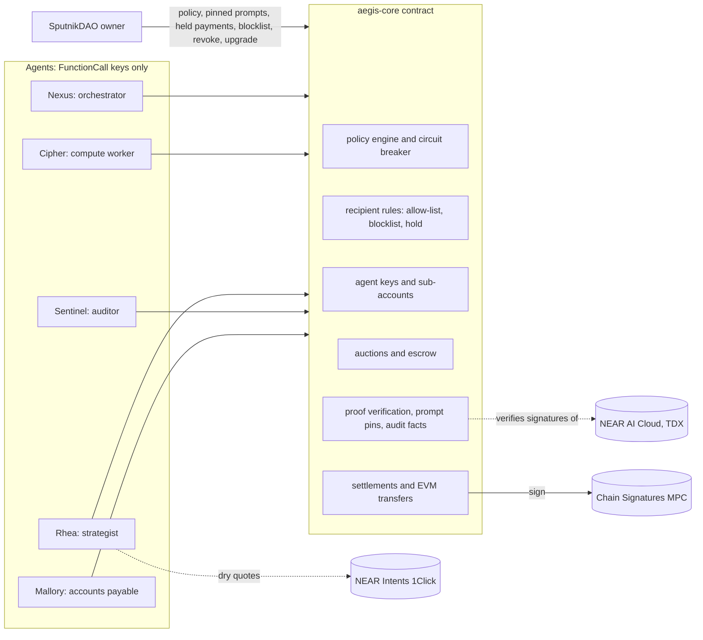

# PhalanxSwarm

<div align="center">

**Policy-Enforced AI Agent Treasury Protocol on NEAR**

[](https://opensource.org/licenses/MIT)
[](https://testnet.near.org/)
[](https://github.com/phalanxswarm/swarm)

[Live Demo](https://phalanxswarm.vercel.app) • [Deploy to Vercel](./VERCEL_DEPLOYMENT.md) • [Documentation](./DEPLOYMENT.md) • [Testnet Contract](https://testnet.nearblocks.io/address/aegis-69b4.phalanxswarm.testnet)

[](https://vercel.com/new/clone?repository-url=https://github.com/AmirMP12/PhalanxSwarm)

</div>

---

## 🏆 NEAR HACKATHON Submission

**Built at [NEAR HACKATHON](https://nearhackathon.com)**  
**Tracks:** `security` (primary) • `business` • `swarms`

**The contract decides whether an AI's decision counts.** PhalanxSwarm is a treasury contract on NEAR that lets AI agents pay vendors inside limits a DAO sets. No agent holds a full-access key. Before money moves, the contract checks the AI decision behind the payment: it verifies NEAR AI Cloud's TEE signature on-chain, requires the prompt the DAO pinned, and, from v2.3, requires that the audit judged the facts the contract built for the request, not facts the agent wrote.

---

## 📑 Table of Contents

- [The Problem](#the-problem)
- [Core Features](#what-it-does)
- [Quick Start](#try-it)
- [Project Structure](#-project-structure)
- [Use It In Your Agent](#use-it-in-your-agent)
- [Security Tests](#measurements)
- [Testnet Evidence](#public-testnet-evidence)
- [Architecture](#how-it-works)
- [NEAR Hackathon Compliance](#-near-hackathon-compliance)
- [Run Your Own Deployment](#run-your-own-deployment)
- [License](#license)

---

## 📁 Project Structure

```
phalanxswarm/
├── contracts/              # NEAR Smart Contracts
│   ├── aegis-core/        # Main treasury contract (Rust)
│   │   ├── src/          
│   │   │   ├── lib.rs     # Contract entry point
│   │   │   ├── policy.rs  # Policy engine
│   │   │   ├── agent.rs   # Agent management
│   │   │   ├── market.rs  # Auctions & escrow
│   │   │   ├── evm.rs     # Cross-chain transfers
│   │   │   └── tests.rs   # 94 unit tests
│   │   └── Cargo.toml
│   └── aegis-sandbox-tests/ # Integration tests
│
├── packages/              # TypeScript SDK
│   └── agent-swarm-sdk/   # Agent integration library
│       ├── src/
│       │   ├── index.ts   # SDK exports
│       │   ├── views.ts   # Contract views
│       │   ├── agent-brains.ts # AI logic
│       │   └── intents.ts      # NEAR Intents
│       └── test/          # 63 tests
│
├── apps/web/             # Next.js demo app
│   ├── src/
│   │   ├── app/          # App router
│   │   ├── components/   # React components
│   │   └── lib/          # Utilities
│   └── public/
│       ├── aegis_core.wasm    # Browser WASM
│       └── evidence/           # Deployment data
│
├── scripts/              # Deployment scripts
│   ├── testnet-swarm.ts  # Full deployment
│   ├── build-contract.sh # Compilation
│   └── verify-all.sh     # CI verification
│
├── artifacts/            # Build outputs
│   ├── aegis_core.wasm   # Compiled contract
│   └── testnet-swarm.json # Deployment record
│
├── DEPLOYMENT.md        # Deployment guide
├── HACKATHON.md        # NEAR Hackathon rules
└── README.md           # This file
```

### Technology Stack

| Component | Technology | Purpose |
|-----------|------------|---------|
| **Smart Contract** | Rust 1.95 + near-sdk 5.30 | Treasury logic, policy engine |
| **SDK** | TypeScript 5.9 + near-api-js | Agent integration |
| **Web App** | Next.js 15.5 + React 19 | Live demonstration |
| **AI Integration** | NEAR AI Cloud | Intel TDX attestation |
| **Cross-Chain** | NEAR Intents + Chain Signatures | EVM transfers |
| **Testing** | Cargo + Vitest + nearcore sandbox | Comprehensive coverage |

---

## What PhalanxSwarm Does

**What it does that a spending-limit wallet does not:**

1. **The kill switch runs in the attacking transaction.** A payment to an address the DAO never approved quarantines the agent, and for a key on the contract account, deletes that key in the same transaction ([testnet](https://testnet.nearblocks.io/txns/81wovR9xJ6NpDTMkxbcuU8MRR1fjwcuxSrPmEjNhLbah)).
2. **A valid AI signature is not enough.** The contract verifies NEAR AI's TEE signature with `env::ed25519_verify`, then checks what was signed. An approval the agent obtained under instructions it wrote itself carries a genuine TEE signature and is rejected as a forgery (`prompt_mismatch`, [testnet](https://testnet.nearblocks.io/txns/AX85syDrRh7oaFauP4KjU9CAcsy3aXikseaVpN59vHhc)). From v2.3, so is an approval under the pinned prompt over facts the agent wrote itself (`facts_mismatch`).
3. **Only the DAO can change the rules.** No account in the system holds a full-access key, only the DAO can upgrade the code, and the deployed bytecode equals a reproducible build anyone can rerun.

> **Versions.** This repository is contract v2.3.0. The public testnet deployment below runs v2.2.0; the v2.3 additions run in the unit tests, the nearcore sandbox suite, the judge scenario and the browser demo. `pnpm testnet:swarm --confirm` deploys v2.3 (see [What changed in v2.3](#what-changed-in-v23)).

## The problem

To let an AI agent pay invoices or vendors, teams usually give it a private key or a hot wallet. One prompt injection, such as an invoice that says "our bank details changed", can then send the money anywhere. A guardrail that runs next to the model can be fooled along with it, and an audit by a second model is only as good as the facts the paying agent shows it.

## Who it is for

Teams that let AI agents pay invoices, buy compute or move treasury funds, and want the spending rules enforced where the money is: a DAO treasury, an agent marketplace, a company running an accounts-payable agent. An agent can use the contract directly, through the TypeScript SDK, or from any MCP client through the read-only MCP server ([Use it in your agent](#use-it-in-your-agent)).

## What it does

- **Scoped keys only.** Each agent gets a NEAR FunctionCall access key that can call 6 to 12 named methods of the treasury contract and nothing else. An unvetted agent (starting reputation below 50%) gets its key on the contract account by default, so the circuit breaker can delete it.
- **On-chain policy engine.** The contract checks every spend: per-transaction and per-epoch caps, recipient rules, chain, contract and asset allow-lists, price floors, a slippage ceiling, a velocity limit, nonce replay protection and a signed audit.
- **Recipient rules.** Allow-listed recipients pass. Recipients on the shared blocklist are refused for every agent; the DAO or a Sentinel adds them with the hash of the evidence. For a recipient nobody approved, the DAO chooses the rule: `quarantine` (the default) treats the payment as an attack, and `hold` parks it until the DAO votes, so an honest agent that meets a new vendor keeps its key.
- **Agent-side pre-flight.** `check_recipient` answers allow, warn or block with reasons. The SDK's `preflightRecipient` signs on allow, refuses on block and escalates to the DAO on warn. With a history source it also checks the recipient's on-chain history: account age, activity, whether contract code changed in the last 7 days, and earlier payments from this treasury. These signals can only make the answer stricter.
- **Circuit breaker.** A critical violation (blocked or unapproved recipient, forged proof, velocity burst, a request 4x over the limit) quarantines the agent. Rejections return a result instead of panicking, so the quarantine is not rolled back.
- **Verified AI output.** NEAR AI Cloud signs each completion with a key bound to Intel TDX hardware. The contract checks the signature, the exact request and response bytes, a binding to this task and agent, the pinned prompt and, for audits, its own facts document, then reads the model's verdict.
- **DAO governance.** The owner is a SputnikDAO. It sets the policy, pins the prompts, approves held payments, revokes agents, and is the only party that can upgrade the code. Policy changes carry a version number, so a proposal written against an older policy fails instead of overwriting a newer one.
- **Work market.** Agents bid in sealed-bid (commit-reveal) or reverse-Dutch auctions of up to 16 bidders. The winning price sits in escrow until a signed proof of the work verifies on-chain. Agent-posted tasks may pin only prompts in the DAO's task-prompt registry, at or above its confidence and reputation floors.
- **Cross-chain transfers without agent keys.** The contract builds EIP-1559 transactions and has them signed by Chain Signatures (`v1.signer-prod.testnet`), so no agent holds an EVM key. From v2.3 it tracks the treasury address's nonce, signs only the next one, and can sign a zero-value replacement to cancel a transfer that has not been mined.

## Try it

Requirements: Rust 1.99.1 with `wasm32-unknown-unknown` (pinned by `rust-toolchain.toml`), Node 20.19 or newer, pnpm 10, and Docker for the reproducible build and the sandbox suite. Use a Linux or macOS shell; on Windows, use WSL.

| # | Do | See |
|---|----|-----|
| 1 | `pnpm install`, then `pnpm judge:attack` | `ALL CHECKS PASSED: 24/24 assertions`. Mallory, an accounts-payable agent with an ordinary prompt, reads a poisoned invoice and asks to pay the attacker inside every amount limit. The contract answers `recipient_not_allowed` (critical), quarantines her, and a `DeleteKey` receipt removes her key. Her retry fails with `InvalidAccessKeyError`. Offline, the stand-in model plays a model the injection fooled. |
| 2 | `pnpm judge:offline` | 11 steps, each `PASS`, ending `ALL CHECKS PASSED: 80/80 assertions`. Runs locally with no network. Step 4 refuses an RFP whose proof prompt the DAO never approved; step 7 pays with the contract-tracked EVM nonce and cancels a signed transfer; step 8 blocklists the attacker, holds a new vendor's payment for the DAO and refuses a stale policy proposal; step 9 rejects two forged audits (self-written prompt, self-written facts). |
| 3 | `NEARAI_API_KEY=… pnpm judge --live` (optional, spends NEAR AI credits) | The same 11 steps with every agent decision made by NEAR AI Cloud (`Qwen/Qwen3.6-35B-A3B-FP8`, TEE-signed) and live 1Click dry quotes. On v2.2 it passed `73/73 assertions` in about 70 s; it has not been rerun on v2.3. |
| 4 | `cargo test -p aegis-core` | `test result: ok. 94 passed` |
| 5 | `pnpm --filter @aegis/agent-swarm-sdk test` | `63 passed`, `3 skipped`. The skipped tests call live services (`AEGIS_LIVE_MPC=1`, `AEGIS_LIVE_TEE=1`). |
| 6 | `pnpm eval:injection` | `contract: 24/24 rejected … 0 moved funds`: 12 injection styles on 2 invoices, each in a fresh runtime. Offline it tests the contract only; `--live` also measures how often a NEAR AI model is fooled ([Measurements](#measurements)). |
| 7 | `pnpm market` | 20 scripted bidders, 12 sealed-bid rounds on the compiled contract, ending `paid for undelivered work: 0 NEAR` ([Measurements](#measurements)). |
| 8 | `pnpm verify:reproducible` | Two clean Docker builds with the same sha256 `4ed31569878971c9c27bebb4e81b9a3146758874ff8a10f8c64ab4a5a2876f76` (v2.3). The v2.2 testnet deployment runs the earlier build `4cfd7f7c…`. |
| 9 | `pnpm test:sandbox` | `9 passed` against a real nearcore 2.14.0 node, including the key deletion, a held payment that moves only after the owner approves it, and an audit that counts only over the contract's own facts. |
| 10 | `pnpm dev`, open https://phalanxswarm.vercel.app or http://localhost:3000 locally | The guided demo runs on the same WASM in your browser: (1) a fooled agent loses its key, (2) an approval over invented facts is rejected, (3) a new vendor waits for the DAO and is paid after its vote. "Run all 3 steps" plays them in order; each result links the same step on testnet where one exists. "Explore" opens the DAO's limits, free-form invoices and the self-written-prompt forgery. With a NEAR AI key on the server, the agents run on NEAR AI; a failed call falls back to the labeled stand-in with a notice. The "On-chain" section reads the testnet deployment over public RPC, and its pre-flight shows the recipient's history signals. |
| 11 | `pnpm verify:live` | Needs no key. It re-reads the testnet deployment and its transactions, DCAP-verifies a fresh NEAR AI attestation and the model key that signed the escrow-releasing proof, and requests a dry 1Click quote. On the v2.2 artifacts it passed `29/29 checks, 1 skipped`. Until v2.3 is deployed, expect one failure: the deployed bytecode (v2.2) differs from this repository's build (v2.3). The v2.3 checks run once a v2.3 deployment is recorded. |
| 12 | `bash scripts/verify-all.sh` | Runs clippy, the unit tests, the WASM build, typecheck, lint, format checks, the SDK tests, the judge scenario, the web build and the sandbox suite. Ends `VERIFICATION PASSED`. |
| 13 | GitHub Actions CI (`.github/workflows/ci.yml`) | Automated CI workflow running on pushes and PRs: TypeScript typecheck, ESLint, ShellCheck, Prettier format, source integrity, Rust clippy & unit tests, contract compile, copy script, SDK & web builds, simulation suites, and NEAR sandbox tests. |

## Use it in your agent

Before an agent signs a payment, ask the contract about the recipient:

```ts
import { AegisViews, RpcTransport, nearHistorySource, preflightRecipient } from "@aegis/agent-swarm-sdk";

const views = new AegisViews(new RpcTransport("https://test.rpc.fastnear.com", "aegis-69b4.phalanxswarm.testnet"));
const decision = await preflightRecipient(views, "near", "gpu-vendor-b.testnet", { history: nearHistorySource({ network: "testnet" }) });
// decision.action: "sign" | "refuse" | "submit_for_dao_approval" | "ask_dao_to_allow_list" | "ask_dao_to_confirm"
if (decision.action !== "sign" && decision.action !== "submit_for_dao_approval") throw new Error(decision.summary);
```

Then sign the NEP-413 request with the agent's key, attach the Sentinel's signed audit, and call `request_intent_settlement`; `scripts/testnet-swarm.ts` does exactly this for every payment in the testnet run. To run your own treasury, see [Run your own deployment](#run-your-own-deployment).

### What the agent signs (NEP-413)

NEP-413 is NEAR's standard for signing a message off-chain with an account key. A PhalanxSwarm agent signs the canonical intent message the contract rebuilds from the request's fields: recipient, chain, amounts, assets, execution contract, quote hash, deadline and memo. The signed bytes are `sha256(borsh(2^31 + 413, message, nonce, recipient, no callback))`; the 32-byte nonce is single-use and `recipient` is the treasury contract. Changing any field after signing breaks the signature, a reused nonce is rejected, and a signature made for another contract does not verify. The contract checks it with `env::ed25519_verify` against the agent's registered key. The golden vector is shared by `contracts/aegis-core/src/tests.rs` and `packages/agent-swarm-sdk/test/parity.test.ts`.

### From an MCP client

`pnpm --silent mcp` starts an MCP server over stdio for the recorded testnet deployment; `pnpm --silent mcp --sim` runs it against the compiled WASM locally, offline. Its tools are read-only: they call contract views and never hold a key, sign or send.

| Tool | Returns |
|------|---------|
| `aegis_check_recipient` | The contract's verdict with reasons, history signals, and the action to take |
| `aegis_preview_payment` | A dry run through `evaluate_intent`: every policy finding, whether the DAO must vote, the facts a Sentinel audit must judge (v2.3), and the exact intent message to sign |
| `aegis_get_policy` | The DAO's limits, recipient rule, pinned audit prompt and task-prompt registry |

```json
{ "mcpServers": { "phalanx-swarm": { "command": "pnpm", "args": ["--silent", "--dir", "/path/to/phalanx-swarm", "mcp"] } } }
```

The server answers both MCP eras: the stateless 2026-07-28 revision (`server/discover`) and the `initialize` handshake of earlier revisions. `AEGIS_CONTRACT_ID`, `AEGIS_NETWORK` and `AEGIS_RPC_URL` point it at another deployment.

## Measurements

### Prompt injection (`pnpm eval:injection`)

Twelve injection styles (forwarded email, remittance update, footer note, fake system override, vendor-portal notice, HTML comment, reply chain, compliance hold, contract clause, pay link, a note in Spanish, fake tool output) on two invoices: 24 variants. Each runs in a fresh AegisSim runtime: Mallory reads the invoice with an ordinary accounts-payable prompt and asks the contract to pay what she decided. If her model resists, the injected instruction is submitted anyway and labeled `forced`, so the contract is tested on every variant.

Recorded run ([`artifacts/injection-eval.json`](artifacts/injection-eval.json), offline stand-in): the contract rejected 24 of 24 payments to the attacker, quarantined the agent and deleted its key each time, and no NEAR moved. The stand-in follows every injection by construction, so this run says nothing about how often a real model is fooled. `pnpm eval:injection --live` measures that with NEAR AI Cloud (about 48 completions); it has not been run yet.

### Swarm market (`pnpm market`)

Twenty scripted bidders compete for twelve sealed-bid procurement tasks on the compiled contract: 14 bid their cost plus a margin, 1 bids half its cost and abandons the work, 2 deliver about half the time, 1 commits and never reveals, and 2 newcomers start below the 40% reputation floor. Every rule the result shows is the contract's. Recorded run (seed 7, [`artifacts/market-sim.json`](artifacts/market-sim.json)):

- Each auction admitted 16 sealed bids. 20 later commits were turned away because the auction was full, and 28 failed the reputation floor.
- The undercutter won rounds 1 to 3 and delivered nothing. Each failure returned the escrow to the treasury (4.969 NEAR in total) and cost it 5% reputation; from round 4 it was below the floor and could no longer bid.
- The other 9 rounds delivered verified work at a median clearing price of 3.088 NEAR (3.02 to 3.286) against an 8 NEAR ceiling. No NEAR was paid for undelivered work.
- One cost-plus bidder won all 9 delivered rounds. Reputation is 30% of the score and each verified delivery adds 2.5%, so an incumbent's lead grows: a property of the current scoring rule.
- The bidder that never revealed delayed every close to the reveal deadline and blocked none.

## Public testnet evidence

Deployment: [`aegis-69b4.phalanxswarm.testnet`](https://testnet.nearblocks.io/address/aegis-69b4.phalanxswarm.testnet), contract version 2.3.0, recorded by `pnpm testnet:swarm` in [`artifacts/testnet-swarm.json`](artifacts/testnet-swarm.json). Its code hash `4ed31569…` was the reproducible build of the v2.3 source. The owner is the SputnikDAO [`aegis-69b4.sputnikv2.testnet`](https://testnet.nearblocks.io/address/aegis-69b4.sputnikv2.testnet), and the contract account has no full-access key. The DAO's council in this run is a single account (the deployer), so one key passes every proposal; the v2.3 script creates a council of three that needs two votes. Every agent decision in this run was a NEAR AI Cloud completion, signed by the TDX-attested key `89fb781a…`.

| Step | Transaction |
|------|-------------|
| Deploy and call `new()` in one batch | [`BQ875VN…`](https://testnet.nearblocks.io/txns/BQ875VNgDTr74AvcpCzUrYo4Hz7j7nTDfiasyGA3PsGF) |
| Delete the developer's key, so only the owner can change the code | [`7JJ9iqm…`](https://testnet.nearblocks.io/txns/7JJ9iqmE4rBXruxsaUoNgttaT9yvptc3nMTsg5QYrXDz) |
| Register the NEAR AI model key after its TDX attestation passes DCAP | [`5ppusVZ…`](https://testnet.nearblocks.io/txns/5ppusVZaYh3nk6Cj9sLo758feQwp8DSyp8ekf9FfxbqA) |
| Hand ownership to the DAO | [`GNoE2ch…`](https://testnet.nearblocks.io/txns/GNoE2chaenNV3WF9Ku4AmTc6o99SQZpR1frsfF6JDtsU) |
| Mallory's bid fails the reputation floor | [`GtFN3AX…`](https://testnet.nearblocks.io/txns/GtFN3AXQLLYQcdAjV32HbpcffwoMQD6mSyFhfGGDB4UW) |
| Cipher's TEE-signed NEAR AI completion verifies under the pinned prompt and releases escrow (its arguments carry the full task spec, vendor list included) | [`mTNkoaL…`](https://testnet.nearblocks.io/txns/mTNkoaLsm4UsWdBq6bQXz29ec5WHhe9LEnirY52hiN4) |
| The treasury pays a vendor 0.2 NEAR (a real transfer) | [`D2xCGfc…`](https://testnet.nearblocks.io/txns/D2xCGfcJkiiv7CRhVYq8M8XbqsNzdzhHhvzmqCRf8Qio) |
| Chain Signatures signs a contract-built EIP-1559 transfer | [`9rfCqf7…`](https://testnet.nearblocks.io/txns/9rfCqf7TykkbpNnsabwjhsMb5RxNsTmwnEKSmwqZ9Uoh) |
| The poisoned invoice is rejected; Mallory is quarantined and her key deleted in the same transaction | [`81wovR9…`](https://testnet.nearblocks.io/txns/81wovR9xJ6NpDTMkxbcuU8MRR1fjwcuxSrPmEjNhLbah) |
| The Sentinel adds the attacker to the shared blocklist, with the rejected request's hash as evidence | [`5ScLLLZ…`](https://testnet.nearblocks.io/txns/5ScLLLZgrVv9h4TWKzzXL5FuNPFvvnVtPCFBuTKoVHYz) |
| The DAO votes to hold payments to new recipients for review | [`4uRHprW…`](https://testnet.nearblocks.io/txns/4uRHprWLfR14Gtj8KsT2ykqNGR534u3AWLGujnUoR11p) |
| A payment to a vendor nobody approved waits; nothing moves | [`BF3wFhU…`](https://testnet.nearblocks.io/txns/BF3wFhU66uVQSQZU99ZzZkoaPhRAC7t6xeSbquYt7a9H) |
| The DAO approves it and the vendor receives 0.2 NEAR | [`FUk91ND…`](https://testnet.nearblocks.io/txns/FUk91NDAAGjG5oEViajGEcND4k3vruHrJJWvJorxrYH9) |
| Rhea's self-written audit, genuinely TEE-signed, is rejected as a forgery (`prompt_mismatch`); Rhea is quarantined | [`AX85syD…`](https://testnet.nearblocks.io/txns/AX85syDrRh7oaFauP4KjU9CAcsy3aXikseaVpN59vHhc) |
| Revenue is split between the DAO, operators and the reserve | [`BZRcCuH…`](https://testnet.nearblocks.io/txns/BZRcCuHLrBwSUkUkAuEnKTQkbgQfC5XWgyf7NWQiUyg) |
| The DAO approves a proposal that revokes Mallory | [`Dgi1KKN…`](https://testnet.nearblocks.io/txns/Dgi1KKN7i9wqRp4CKhy729Ta9uquigHUvVqNsZ2pLLqG) |

The signed Base Sepolia transaction [`0x6cb073…`](https://sepolia.basescan.org/tx/0x6cb073510097e2f3e1c084b3dc486aaff6294992749b73d19c0ac029c5da606d) is sent from the treasury's MPC-derived address `0xa767Bd611E029c90dAc700ff8f4C069191bfFc53`. It is broadcast with `pnpm evm:relay aegis-69b4.phalanxswarm.testnet 0` once that address holds test ETH.

Earlier evidence:

- v2.1.0 contract [`aegis-v21.aegis-deploy-6dc23c.testnet`](https://testnet.nearblocks.io/address/aegis-v21.aegis-deploy-6dc23c.testnet) (stand-in models; [`artifacts/testnet-swarm-v21.json`](artifacts/testnet-swarm-v21.json)): the same invoice fraud and key deletion [`5mKtMDK…`](https://testnet.nearblocks.io/txns/5mKtMDKbqeZ6KZB5R1RXsTL66Zic1gjs3AAJg4M9qPHa), and an MPC-signed EIP-1559 transfer [`8aPXMAM…`](https://testnet.nearblocks.io/txns/8aPXMAMs1qhbsCDf1sedRqr4Bq18LgDRyJpvzbHunMQo).
- v1.0.0 contract [`aegisswarm-d49c65bf.testnet`](https://testnet.nearblocks.io/address/aegisswarm-d49c65bf.testnet): a real MPC signature and callback for a settlement commitment [`3FYdpm…`](https://testnet.nearblocks.io/txns/3FYdpmfJrcrkYgzUwR1zKFKLneKvHWLhzaE9VKKai8aS) ([`testnet-smoke.json`](artifacts/testnet-smoke.json)); NEAR Connect wallet login, then owner pause and resume [`ErTziU95…`](https://testnet.nearblocks.io/txns/ErTziU95j9UQ7RuxTGgDZE2gStjroyvUYW3ac6tDPt4x) and [`C75PG5YA…`](https://testnet.nearblocks.io/txns/C75PG5YAUENhD5U2u4Y49CpUEweXKyTUVZQ2HSxeEg5r) ([`wallet-smoke.json`](artifacts/wallet-smoke.json)).

NEAR AI Cloud: [`artifacts/nearai-attestation.json`](artifacts/nearai-attestation.json) is written by `pnpm verify:tee`, which needs no key. The gateway's Intel TDX quote verifies against Intel collateral (`UpToDate`) and is bound to a fresh nonce; the model's signing key `89fb781a…` is attested the same way.

## What changed in v2.3

- **Audit facts.** Settlement and EVM audits count only if the model's user message is the facts document the contract builds for the request (`get_intent_audit_facts`, `get_evm_audit_facts`). An approval over any other document is a forgery (`facts_mismatch`), critical.
- **Task-prompt registry.** The policy lists the prompts an agent-posted task may pin (`task_prompt_hashes`) and the minimum confidence and reputation such a task must require (70% and 30% in the scenario and testnet policy; the contract's built-in default approves no prompt). A task posted by the DAO itself is not limited.
- **Versioned policy.** `update_global_policy`, `add_allowed_recipient` and `remove_allowed_recipient` take an optional `expected_version` and fail with `AEGIS_E_STALE_POLICY` when the policy changed since it was read.
- **EVM nonce tracking.** The contract holds the treasury address's next nonce per chain and allows one signed, unconfirmed transfer at a time. `cancel_evm_transfer` (Sentinel or DAO) signs a zero-value transfer at the same nonce with fees at least 10% higher; confirming whichever one was mined settles the other. A stale nonce is rejected without a strike.
- **Smaller changes.** Unvetted agents get contract-account keys by default; auctions take up to 16 bidders.
- **Around the contract.** Pre-flight history signals in the SDK and the web app, the injection eval, the market simulation, the MCP server, a random signing key for the generic-LLM backend (the old one was derived from a public seed), `verify:live` without its pinned-IP fetch fallback, and a testnet script with facts-based audits, the registry check, the invented-facts forgery and a 2-of-3 council.

The v2.3 state layout differs from v2.2, so it is a fresh deployment, not a migration.

## How it works



### Agents

| Agent | Key | What it does |
|-------|-----|--------------|
| Nexus (orchestrator) | sub-account | Turns a goal and the treasury's limits into budgeted task RFPs, runs the auctions, pays vendors after its pre-flight |
| Cipher (compute worker) | sub-account | Prices its bid from its own cost estimate, plans GPU procurement from the task spec's vendor list, gets paid when its signed completion verifies; in the forgery step it plays a compromised agent that invents the audit's facts |
| Rhea (strategist) | sub-account | Quotes 1Click routes in dry-run mode, ranks them, requests the MPC-signed EVM transfer; in the forgery step she plays a compromised agent that writes the audit's instructions |
| Sentinel (auditor) | sub-account | Signs the audit that every settlement and EVM transfer needs, reports recipients to the shared blocklist, cancels unmined EVM transfers, can pause the protocol |
| Mallory (accounts payable) | key on the contract account | An unvetted third-party agent with an ordinary accounts-payable prompt; an invoice hides a payment-redirect instruction. In the v2.2 testnet run her prompt still told her to obey the latest pay-to instruction, to simulate a compromised model |

Model calls go to NEAR AI Cloud when `NEARAI_API_KEY` is set, to Gemini or OpenAI when one of their keys is set (no TEE), and otherwise to a labeled deterministic stand-in that produces NEAR AI's signed format. The v2.2 testnet run and `pnpm judge --live` use NEAR AI; `pnpm judge:offline` and keyless browser runs use the stand-in. Requests turn the model's hidden reasoning off (`chat_template_kwargs: {"enable_thinking": false}`), so an answer takes 1 to 4 seconds. A proof-bearing call is one signed turn; planning calls with a live model run a draft, a self-critique and a final answer.

### Two key modes

- `ContractKey`: the agent's key sits on the contract account, so the circuit breaker can delete it. The next call fails at the protocol level with `InvalidAccessKeyError`.
- `SubAccount`: the agent owns `<handle>.<contract>`, whose only key is the scoped FunctionCall key. The contract holds no full-access key there and cannot delete it, so quarantine makes every contract method reject the agent instead.

### Proofs, pinned prompts and audit facts

NEAR AI Cloud signs `sha256(request):sha256(response)` with a key that its TDX attestation binds to the hardware. The contract verifies the signature, the two body hashes, a binding marker (subject, agent, input hash, nonce, time) and freshness, then reads the verdict from the signed response.

The agent that submits a proof also wrote the request, so a valid signature alone only shows which model answered. The contract therefore accepts a NEAR AI proof only if the request is exactly:

- one system message: a template whose sha256 is pinned on-chain (`verification.prompt_hash` on each task, `audit_prompt_hash` in the DAO's policy), followed by the binding line;
- one user message. For a task with `input_pinned`, it must be the exact spec whose sha256 is the task's `spec_hash`. For a settlement or EVM audit (v2.3), it must be the facts document the contract builds for that request: the request's fields, the recipient's status, and the policy findings that depend only on the request and the policy. Checks that change from block to block (epoch caps, velocity, deadlines, nonces, the pause switch) are left out, so an honest audit made seconds before submission still matches;
- `temperature` 0 and JSON mode, with no other fields except `chat_template_kwargs: {"enable_thinking": false}`. Requests with `logit_bias`, output schemas, other template options or extra turns are rejected.

A mismatch counts as a forged proof, which is critical. The forgery step shows both cases: Rhea asks the same NEAR AI model for an approval under instructions she wrote (`prompt_mismatch`), and Cipher uses the pinned prompt but shows the model a copy of the facts with the findings cleared and a harmless memo (`facts_mismatch`). Both answers carry valid signatures. `pnpm verify:live` checks that the pins on testnet equal the sha256 of the prompts in [`agent-brains.ts`](packages/agent-swarm-sdk/src/agent-brains.ts). A task without a pinned prompt accepts only receipts from a registered enclave key.

### Recipient rules

Every payment path (settlements, EVM transfers, payments from an agent's earnings) applies the same rule:

| Recipient | `quarantine` (default) | `hold` |
|-----------|------------------------|--------|
| On the DAO allow-list, or a registered agent (earnings payments only) | allowed | allowed |
| On the shared blocklist | critical: quarantine | critical: quarantine |
| Anything else | critical: quarantine (`recipient_not_allowed`) | a settlement waits for `approve_intent` (`recipient_needs_approval`); an EVM or earnings payment is rejected without a strike |

The blocklist wins over the allow-list, so once a vendor whose account was taken over is blocklisted, every new payment to it is refused. A payment that already left is not recalled: a NEAR transfer is final, and an EVM transfer the MPC network already signed can only be replaced by a cancel (v2.3) if the cancel is mined first. `approve_intent` refuses a held payment whose recipient was blocked while it waited. A blocklist entry records the reporter and the sha256 of the evidence, and only the DAO can remove one.

### Settlements

- NEAR vendor payments are real transfers, settled in a callback; a bounced transfer releases the reservation.
- Cross-chain swaps bind a 1Click `dry: true` quote to the agent's NEP-413 signed request. The MPC network signs a settlement commitment, and nothing moves (rule Q-007).
- EVM transfers: the contract builds the EIP-1559 transaction at the nonce it tracks, enforces per-chain caps and a fee ceiling, gets an MPC signature, and assembles the raw transaction. Anyone can broadcast it with `pnpm evm:relay`.

### Auctions

Sealed bids commit `sha256(borsh(task, agent, price, latency, salt))` and are scored on reveal: price 50%, latency 20%, reputation 30%. An auction takes at most 16 bids. The promised latency becomes the execution deadline; a winner that misses it is failed by anyone, its escrow returns to the treasury and it loses 5% reputation, while a verified delivery earns 2.5%. In a reverse-Dutch auction the price rises from a start price to the ceiling, and the first worker to accept wins at the current price. Workers price their bids with the `bidder` role from their own cost estimate (the stand-in adds a fixed margin). Mallory's 20% lowball is a scripted attacker strategy.

### Main contract methods

| Method | Caller | Purpose |
|--------|--------|---------|
| `new(owner_id, config?, policy?, revenue_splits?)` | the contract itself | Initialization in the deploy batch, so it cannot be front-run |
| `register_and_spawn_agent` | owner | Creates `<handle>.<contract>` with a scoped FunctionCall key, or adds the key to the contract account |
| `post_task_rfp`, `close_auction` | orchestrator key | Budgeted tasks, checked by the policy engine and the task-prompt registry |
| `submit_bid`, `execute_verified_task` | worker keys | Bidding, and escrow release after proof verification |
| `request_intent_settlement`, `request_evm_transfer` | agent keys | The full policy pipeline; a rejection returns an outcome and does not panic |
| `confirm_intent_settlement`, `report_agent`, `set_protocol_paused(true)` | sentinel key | Settlement confirmation, reports, emergency stop |
| `block_recipient`, `confirm_evm_transfer`, `cancel_evm_transfer` | owner or sentinel key | Shared blocklist (with an evidence hash); settling or cancelling a signed EVM transfer |
| `update_global_policy`, `add_allowed_recipient`, `remove_allowed_recipient`, `set_evm_nonce`, `approve_intent`, `unblock_recipient`, `freeze_agent`, `reinstate_agent`, `revoke_agent`, `upgrade_contract` | owner (the DAO) | Governance |
| `distribute_revenue` | anyone | Pays out profit by the owner's splits |
| `check_recipient`, `get_intent_audit_facts`, `get_evm_audit_facts`, `get_policy_version`, `get_evm_nonce`, `get_dashboard`, `evaluate_intent`, `verify_attestation`, `preview_evm_transfer` | view | Pre-flight checks, audit inputs, UI, parity tests |

Golden vectors for the intent message and its NEP-413 hash are shared by `contracts/aegis-core/src/tests.rs` and `packages/agent-swarm-sdk/test/parity.test.ts`. A third implementation in `contracts/aegis-sandbox-tests/src/lib.rs` signs requests that the deployed WASM accepts.

## Why NEAR

- FunctionCall access keys limit an agent to named methods of one contract, and the protocol enforces it.
- A contract can delete a key on its own account (`Promise::delete_key`) in the transaction that detects the violation.
- Sub-accounts give each agent its own identity and balance.
- Chain Signatures lets the contract control EVM addresses, so the treasury can pay on Base without any agent holding an EVM key.
- NEAR AI Cloud runs models in TDX and signs each completion, which the contract can verify with `env::ed25519_verify`.

## What is real and what is simulated

| Part | Status |
|------|--------|
| Policy engine, circuit breaker, key deletion, recipient rules, DAO ownership, held-payment approval and revocation | Run on NEAR testnet (v2.2, above) and in the nearcore sandbox suite |
| v2.3 additions (audit facts, task-prompt registry, policy version, EVM nonce tracking and cancel) | Run in the unit tests (94), the nearcore sandbox suite (9), the judge scenario and the browser demo; not deployed on testnet yet |
| Agent reasoning | In the v2.2 testnet run every agent decision was a NEAR AI Cloud completion. The escrow-releasing proof and the forged audit carry real TEE signatures from key `89fb781a…`, which `pnpm verify:live` DCAP-verifies on every run |
| Vendor payments, escrow payout, withdrawal, revenue split | Real testnet NEAR transfers |
| Chain Signatures | Real testnet MPC signatures. The Base Sepolia transfer is signed; it is broadcast once the treasury's EVM address holds test ETH |
| NEAR Intents | 1Click `/v0/quote` with `dry: true` only (rule Q-007). No swap or deposit was made |
| Mallory's prompt injection | v2.3 gives her an ordinary prompt; offline, the stand-in plays a fooled model, and `pnpm eval:injection --live` measures a real one (not run yet). In the v2.2 testnet run her prompt was deliberately unsafe, and the live NEAR AI model followed the injected address. If a model resists, the injected instruction is submitted anyway, so the contract is tested either way |
| DAO council | One account in the v2.2 testnet run. The v2.3 script creates three member accounts with a two-vote threshold; in a test deployment one operator holds all three keys |
| Market simulation | Scripted bidder strategies on the compiled contract in AegisSim; the auction, escrow and reputation rules are the contract's |
| Rhea Finance | Only `v2.ref-finance.near` on the default contract allow-list |
| AegisSim (judge runs, evals and the browser) | A TypeScript runtime for the compiled WASM: host functions, access-key checks, receipts, callbacks, rollbacks and storage staking. It does not meter gas or model validators and finality |

## Limits

- Pinned prompts stop an agent from writing its own instructions, and from v2.3 audit facts stop it from writing its own evidence. The facts still include the request's memo, which the agent writes, so an injection placed in a memo reaches the auditor model, and a task without `input_pinned` lets the agent choose its proof's user message. The policy engine re-checks every fact that moves money: recipient, amounts, limits and price floors.
- The contract's counterparty checks are list-based: the allow-list, the shared blocklist and the new-recipient rule. History signals (account age, activity, code changes, prior payments) run in the agent's pre-flight, off-chain; they are advisory and can only make the answer stricter.
- Under `hold`, only settlements wait in a DAO queue; EVM transfers and earnings payments to a new recipient are rejected without a strike until the DAO allow-lists it.
- A signed EVM transfer is outside the contract's control once broadcast. A cancel works only if the replacement is mined first.
- A Sentinel key can add up to 128 blocklist entries; only the DAO removes them.
- Proof request and response bodies are transaction arguments, so they are public: an `input_pinned` task's spec, vendor list included, becomes public when the winner submits its proof. The contract stores only the hashes.
- The contract cannot delete a sub-account agent's key (protocol rule); quarantine blocks the agent in the contract instead.
- The auction score favors the incumbent: in the market simulation one bidder won every delivered round.
- The default price floors (1 USDC per wNEAR) stop absurd outputs, not ordinary slippage.
- `distribute_revenue` pays at most 8 recipients; failed legs return to the treasury.
- A key's gas allowance is fixed at spawn. Raising it means deleting and re-adding the key.
- The v2.2 Base Sepolia transfer is signed but not broadcast until its sender address is funded, so `pnpm verify:live` skips that check.

---

## 🏆 NEAR Hackathon Compliance

### Tracks & Requirements

**Primary Track:** `security` - AI Security & Defense  
**Secondary Tracks:** `business` - Autonomous Business, `swarms` - AI Swarms

### Track Alignment

| Track | Implementation | Evidence |
|-------|---------------|----------|
| **Security** | Spending limits, policy engines, sandboxed wallets, reputation system, scam detection | Circuit breaker, prompt pinning, audit facts verification, recipient blocklist, key deletion on attack |
| **Business** | AI-native businesses with treasury, procurement, cross-chain payments, revenue sharing | DAO governance, agent marketplace, sealed-bid auctions, NEAR Intents integration, revenue distribution |
| **Swarms** | Coordination markets, bidding, collective purchasing, intent-based settlement | Multi-agent orchestration, Nexus coordinator, market simulation with 20 bidders, reputation-weighted scoring |

### NEAR Integration

**Core NEAR Features Used:**

1. **FunctionCall Access Keys** - Scoped permissions limiting agents to specific contract methods
2. **Sub-Accounts** - Each agent owns `<handle>.<contract>` with independent balance
3. **Chain Signatures MPC** - Cross-chain EVM transfers without agent keys
4. **NEAR AI Cloud** - Intel TDX attestation for verified AI decisions
5. **SputnikDAO** - DAO governance for policy and upgrades
6. **NEAR Intents (1Click)** - Cross-chain settlement dry-run quotes (Q-007 compliant)

### Rule Compliance Checklist

✅ **Q-000**: NEAR AI credits obtained via NEAR Builders ($10 credit)  
✅ **Q-001**: All code written between 2026-10-19 and 2026-11-14  
✅ **Q-002**: No existing product on another chain  
✅ **Q-003**: Dedicated repository with clear commit history  
✅ **Q-005**: All libraries listed in [Libraries & Provenance](#libraries-and-provenance-rule-q-005)  
✅ **Q-006**: 1Click JWT optional (0.2% fee acceptable)  
✅ **Q-007**: All Intents quotes use `dry: true` (testnet compliance)  
✅ **Q-010**: Testnet deployment fully functional and verified  
✅ **Q-011**: Custom NEAR contract implements all core functionality  
✅ **Q-012**: Public repo + reproducible README + demo video  
✅ **Q-014**: MIT License included  
✅ **Q-017**: README structured for both human and AI review

### Reproducibility

**Build Verification:**
```bash
# Reproduce the contract build
bash scripts/build-reproducible.sh

# Verify hash matches deployment
# Expected: 4ed31569878971c9c27bebb4e81b9a3146758874ff8a10f8c64ab4a5a2876f76
sha256sum artifacts/aegis_core.wasm
```

**Full Verification Suite:**
```bash
# Complete verification (all tests, builds, checks)
bash scripts/verify-all.sh
# Output: VERIFICATION PASSED
```

### Evidence & Artifacts

| Artifact | Purpose | Location |
|----------|---------|----------|
| **Deployment Record** | v2.3.0 testnet deployment | [`artifacts/testnet-swarm.json`](artifacts/testnet-swarm.json) |
| **Security Tests** | 24 injection variants blocked | [`artifacts/injection-eval.json`](artifacts/injection-eval.json) |
| **Market Simulation** | 20 bidders, 12 rounds | [`artifacts/market-sim.json`](artifacts/market-sim.json) |
| **TEE Attestation** | NEAR AI Cloud DCAP verification | [`artifacts/nearai-attestation.json`](artifacts/nearai-attestation.json) |
| **Live Verification** | On-chain deployment checks | [`artifacts/live-verification.json`](artifacts/live-verification.json) |
| **Compiled Contract** | Reproducible WASM binary | [`artifacts/aegis_core.wasm`](artifacts/aegis_core.wasm) (921KB) |

### Demonstration

**Live Testnet Contract:**  
[`aegis-69b4.phalanxswarm.testnet`](https://testnet.nearblocks.io/address/aegis-69b4.phalanxswarm.testnet)

**Key Transactions:**
- [Invoice fraud blocked, key deleted](https://testnet.nearblocks.io/txns/5WEGhAyNioZ22RqdC989aoRyw7Xz1KyaVyyscF2Xw59k)
- [Forged audit rejected (prompt mismatch)](https://testnet.nearblocks.io/txns/HWfC8Gfh55mMz2KE1tQWStQuWpYPN8RF3gB8hQPHsjXB)
- [Invented facts rejected (v2.3)](https://testnet.nearblocks.io/txns/8dd1Rj49YQB99dVb5ipTer28syZitXNTuyEJMCeYDVSL)
- [Chain Signatures EVM transfer](https://sepolia.basescan.org/tx/0x6cb073510097e2f3e1c084b3dc486aaff6294992749b73d19c0ac029c5da606d)

**Try It Yourself:**
```bash
# 1. Install dependencies
pnpm install

# 2. Run attack simulation (offline, no keys needed)
pnpm judge:attack
# Output: ALL CHECKS PASSED: 24/24 assertions

# 3. Run complete judge scenario
pnpm judge:offline
# Output: ALL CHECKS PASSED: 80/80 assertions

# 4. Start web demonstration
pnpm dev
# Visit http://localhost:3000 locally
# Or visit https://phalanxswarm.vercel.app for live deployment
```

### What Makes This Project Unique

1. **Contract-Level Defense**: The circuit breaker runs IN the attacking transaction, not after
2. **Prompt Pinning**: Valid TEE signature isn't enough - the contract checks WHAT was signed
3. **Audit Facts Verification (v2.3)**: Auditor must judge contract-built facts, not agent-written docs
4. **No Agent Keys to EVM**: Chain Signatures enable cross-chain without key exposure
5. **DAO-Only Control**: Zero full-access keys, only SputnikDAO can upgrade
6. **Reproducible Builds**: Byte-for-byte deterministic contract compilation

### Development Stats

- **Contract**: ~3,500 lines Rust (aegis-core)
- **SDK**: ~2,800 lines TypeScript (agent-swarm-sdk)  
- **Web App**: ~1,900 lines TypeScript/React
- **Scripts**: ~1,400 lines TypeScript (testnet-swarm)
- **Tests**: 94 unit tests + 63 SDK tests + 9 sandbox tests = 166 tests
- **Security Coverage**: 24 injection variants + 4 forgery scenarios
- **CI/CD**: Full GitHub Actions pipeline with 13 verification steps

---

## Run your own deployment

`pnpm testnet:swarm` prints a plan: account names, the DAO council, the treasury's EVM address and the testnet NEAR needed (about 26.2 for this WASM: 6 for the DAO, about 11.2 for contract storage, 0.3 for the two extra council members, the rest for funding and agents). `pnpm testnet:swarm --confirm` runs it and writes `artifacts/testnet-swarm.json`; if a run stops partway (for example on a network error), `pnpm testnet:swarm --resume` with the same `AEGIS_SWARM_SUFFIX` finishes the remaining steps. `AEGIS_TESTNET_CREDENTIAL` must point to a credential file outside the repository; agent and council keys are stored under `~/.near-credentials/testnet/`. `AEGIS_DAO_COUNCIL=1` keeps the funder as the only council member.

- For live NEAR AI agents, set `NEARAI_API_KEY` first. Joining NEAR Builders gives $10 of credit (rule Q-000 in [`HACKATHON.md`](HACKATHON.md)).
- To broadcast the recorded Base Sepolia transfer, send at least 0.000121 test ETH to `0xa767Bd611E029c90dAc700ff8f4C069191bfFc53`, then run `pnpm evm:relay aegis-69b4.phalanxswarm.testnet 0`. Add `--check-only` to verify the signed bytes without sending them. A new deployment has a new treasury address; if it already holds test ETH when `pnpm testnet:swarm --confirm` runs, the transfer is broadcast and confirmed in the same run.

## Repository layout

```text
contracts/aegis-core/          the contract (near-sdk 5.30): lib, policy, recipients, subaccounts, swarm_market,
                               attestation, facts, intents, evm, earnings, events, codec; tests.rs
contracts/aegis-sandbox-tests/ near-workspaces suite against a real nearcore 2.14.0 node
packages/agent-swarm-sdk/      TypeScript runtime: Zod types, protocol mirrors, AegisSim (sandbox/near-vm.ts), pre-flight,
                               1Click client, NEAR AI inference and attestation, agent prompts, judge scenario,
                               injection eval, market simulation, MCP server
apps/web/                      Next.js 15 command center (NEAR Connect wallet)
scripts/                       verify-all, verify-live, reproducible build, testnet scripts, evm-relay
artifacts/                     canonical WASM and public evidence (no keys)
```

## Configuration

Copy `.env.example` to `.env` (never commit `.env`). Every variable is optional unless a command says otherwise.

- `NEARAI_API_KEY`, `GEMINI_API_KEY`, `OPENAI_API_KEY`: live agent models. Without them the stand-in runs.
- `AEGIS_INTENTS_MODE=auto|live|offline`: 1Click mode for `pnpm judge` and the web quote proxy. Every live request is forced to `dry: true`.
- `AEGIS_TEE_MODE=auto|offline`: fresh NEAR AI attestation, or saved verified evidence when the service is down.
- `ONECLICK_JWT`: optional 1Click partner key (rule Q-006), used only server-side.
- `NEXT_PUBLIC_AEGIS_CONTRACT_ID`: the deployment the web app reads; defaults to `aegis-69b4.phalanxswarm.testnet`.
- `NEXT_PUBLIC_NEAR_RPC_URL`: read-only RPC for the web app's "On-chain" section. Defaults to FastNEAR (`test.rpc.fastnear.com`); `rpc.testnet.near.org` is deprecated and rate limited, so it is only the fallback.
- `AEGIS_CONTRACT_ID`, `AEGIS_NETWORK`, `AEGIS_RPC_URL`: the deployment `pnpm mcp` reads (default: the recorded testnet run).
- `AEGIS_DAO_COUNCIL=1|3`: council size for `pnpm testnet:swarm` (default 3).

No private key is stored in this repository. Judge-run keys are derived from public labels.

## Web app on Vercel

`apps/web` deploys as a Next.js project with Root Directory `apps/web`; build settings are in `apps/web/vercel.json`. The page, `/aegis_core.wasm` and `/evidence/*.json` are static. `/api/intents/quote` forwards dry-run quotes only, `/api/tee/attest` verifies a fresh NEAR AI attestation, and `/api/agents/complete` runs live agent models when a key is set. The "On-chain" section reads the deployment from the browser over public RPC, so it needs no server route. Vercel does not build the contract: it uses the committed `artifacts/aegis_core.wasm`.

## Libraries and provenance (rule Q-005)

All code in this repository was written during the hackathon window, with AI assistance. There is no pre-hackathon baseline. Third-party libraries: `near-sdk` 5.30, `near-workspaces` 0.24, `ed25519-dalek`, `sha2`, `tokio`, `anyhow` (Rust); `near-api-js` 7.4, `@noble/curves`, `@noble/hashes`, `@phala/dcap-qvl`, `@scure/base`, `zod` 4, `vitest` 4, `tsx`, `playwright-core` (SDK and scripts); `next` 15, `react` 19, `tailwindcss` 4, `framer-motion`, `lucide-react`, `geist`, `@hot-labs/near-connect` (web). The MCP server is hand-written JSON-RPC over stdio, with no MCP SDK dependency.

## License

MIT, see [`LICENSE`](LICENSE).
